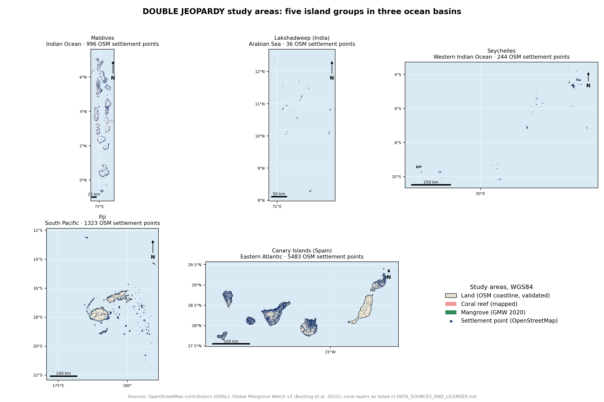
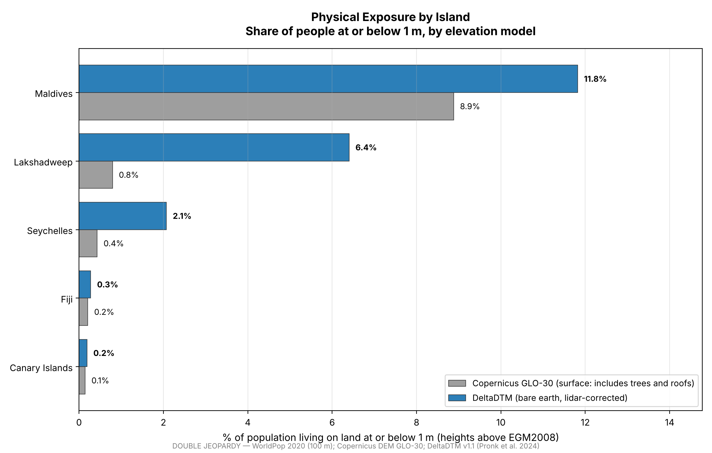
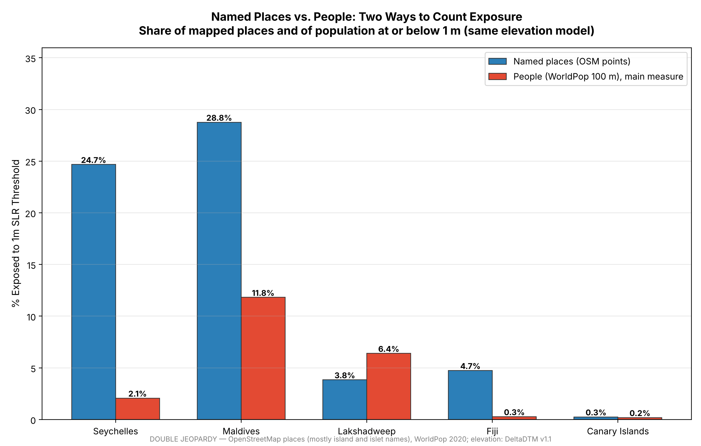
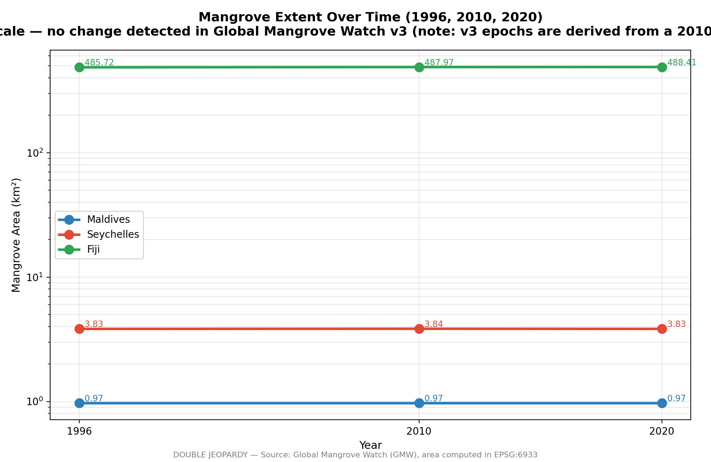
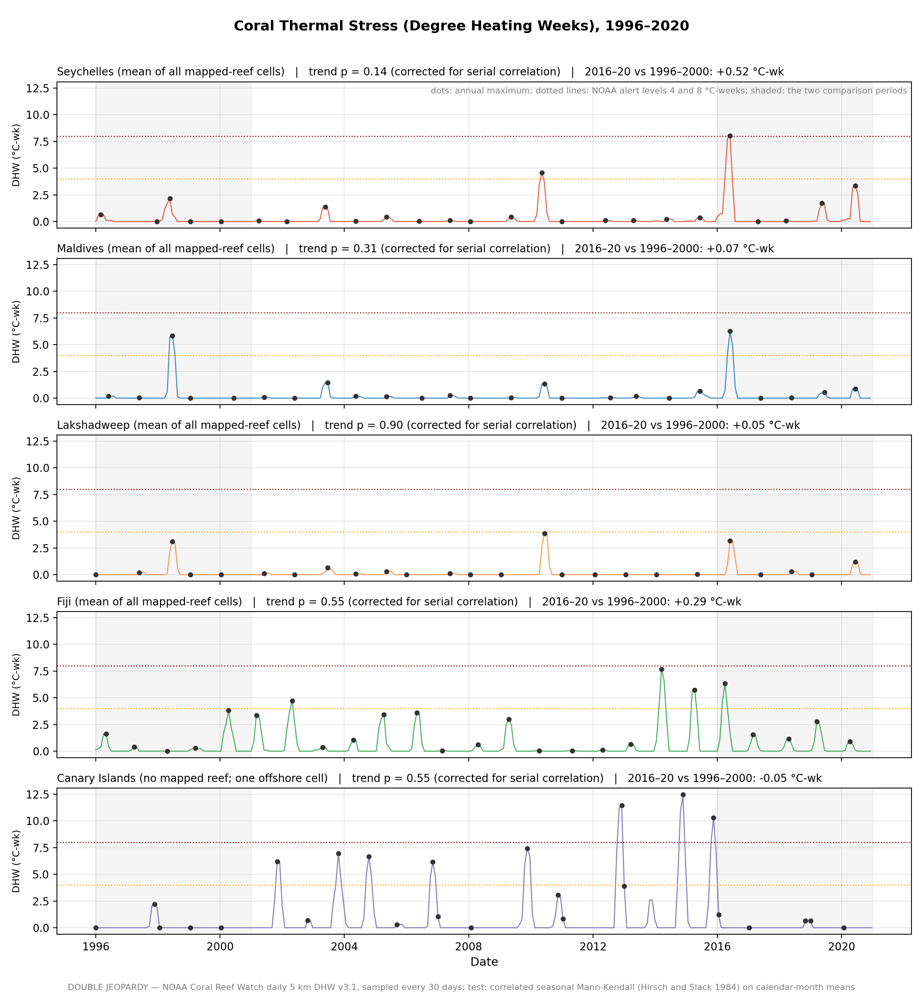
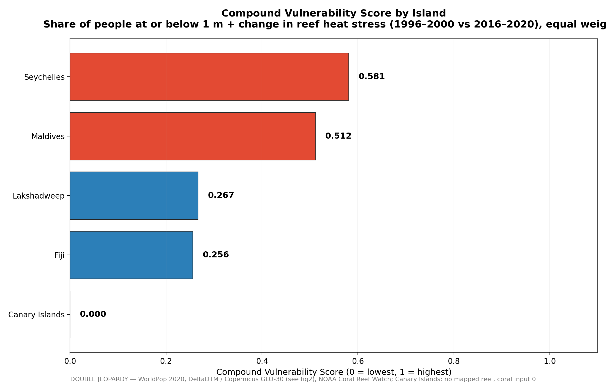
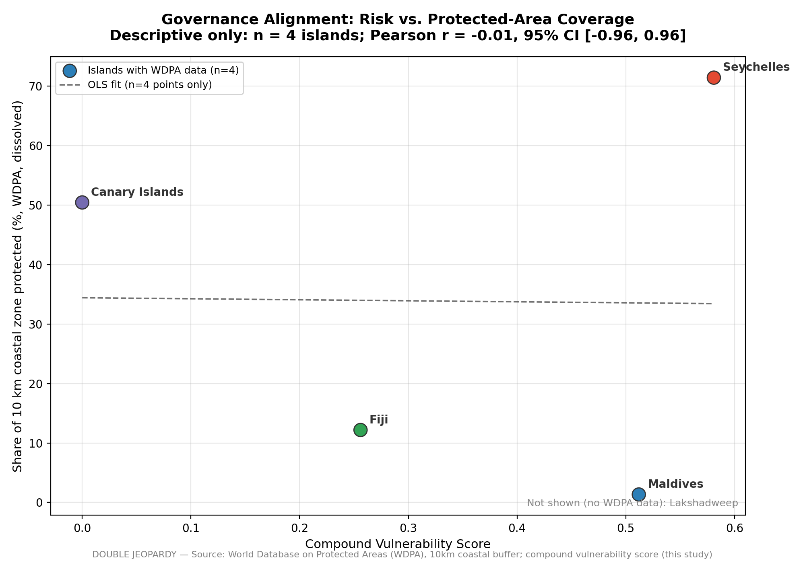
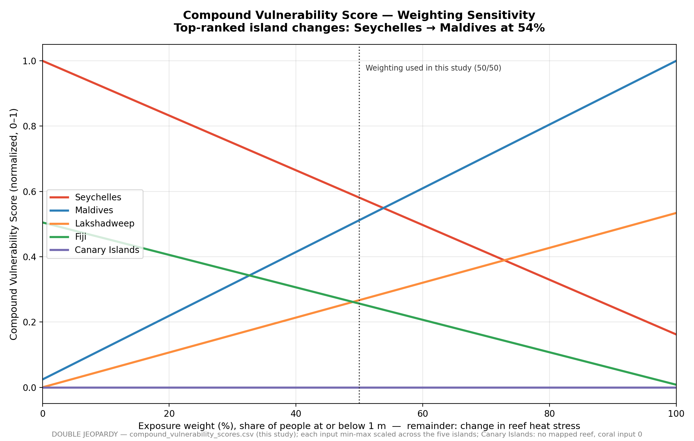

# DOUBLE JEOPARDY: The Vulnerability Spiral of Compound Climate Risk Across 5 Islands

Sakshi D. Maske

*Independent Geospatial Researcher*

## Abstract

Low islands face two threats at once: the sea rising, and the reefs and mangroves that buffer it weakening. I measured both across 5 island groups in 3 ocean basins (Maldives, Lakshadweep, Seychelles, Fiji and the Canary Islands), testing mangroves and coral reefs as separate pathways. Exposure is the share of people (WorldPop 2020) living on land at or below 1 m, on a bare earth elevation model (DeltaDTM v1.1), with the Copernicus GLO-30 surface model and the share of OpenStreetMap named places as comparisons. On bare earth, 11.8% of people in the Maldives and 6.4% in Lakshadweep live at or below 1 m, against 8.9% and 0.8% on the surface model; counting named places instead puts Seychelles (24.7%) level with the Maldives (28.8%). Mean Degree Heating Weeks over mapped reef were higher in 2016–2020 than in 1996–2000 on all 4 reef islands, most in Seychelles (+0.52 °C-weeks), but no monotonic trend is significant once serial correlation is accounted for (corrected seasonal Mann-Kendall p = 0.14 to 0.90). Mangrove extent (Global Mangrove Watch, 1996, 2010, 2020) shows no decline. A compound score of exposure and reef heat stress puts Seychelles (0.58) and the Maldives (0.51) in a near tie, with the top island changing at an exposure weight of 54%. Protection of the 10 km coastal zone ranges from 1.3% (Maldives) to 71.4% (Seychelles) and does not follow this score (r = −0.01, n = 4, descriptive only). This is version 2 of the study; version 1 reported significant coral trends, a ranking robust to weighting and a strong governance correlation, and Section 6.1 explains why none of those held. The main result is about method: the elevation model, the exposure measure and the weighting each change which island looks most vulnerable, and an index used to allocate adaptation resources should report all three.

**Keywords**: sea level rise, digital terrain model, coral bleaching, mangroves, compound vulnerability, small island states, protected areas, remote sensing

---

## 1. Introduction

International climate adaptation policy increasingly treats coastal ecosystems (mangroves, coral reefs, seagrass beds) as a single protective category, financed and managed under the umbrella term "nature based solutions." A substantial body of research documents that these ecosystems really do provide measurable coastal protection. Reef structures dissipate wave energy before it reaches shore, and dense mangrove stands can reduce wave heights by well over half and, where wide enough, storm surge peak water levels too. Small island developing states are frequently identified as the setting where this protective value is proportionally greatest relative to national economic output.

What's less frequently tested is whether the ecosystems providing that protection are themselves degrading uniformly, or whether adaptation planning that treats them as 1 undifferentiated buffer risks obscuring truly different underlying trajectories. I address that gap directly here, testing mangrove extent and coral reef condition as 2 independent pathways, across a properly cross national, multi ocean basin sample, without assuming up front that they move together.

**Research question.** Across five island groups in three ocean basins, how many people live on land at or below 1 m, how has heat stress on their reefs and the extent of their mangroves changed between 1996 and 2020, and does combining exposure with reef heat stress change how the islands rank? Two hypotheses follow: H1, reef heat stress increased over 1996–2020; H2, mangrove extent declined over the same period. Two secondary, descriptive analyses are reported separately: whether coastal protected area coverage is higher where the combined score is higher (H3, n = 4, descriptive only), and whether built up surfaces expanded on land near the ecosystem buffers between 2016 and 2024.

This is version 2 of the study. Version 1 reported a clean result: Seychelles most exposed, significant coral trends in the Maldives and Seychelles, a ranking that held at every weighting, and protected area coverage strongly tracking risk. Going back through each measurement choice, most of that did not hold up, and Section 6.1 sets out what changed and why. I kept the corrections in the paper because they are part of the result: the same five islands rank differently depending on the elevation model, what is counted as exposure, and how inputs are weighted.

A quick note about the title. "Double jeopardy" is the two threats together: the sea rising while the reefs and mangroves that hold it back weaken. "Vulnerability spiral" is used descriptively for that combination. It isn't a claim that this study models a feedback loop between the two. What follows is a cross sectional, multi indicator comparison.

## 2. Literature Review

### 2.1 Nature Based Coastal Protection and Its Assumed Uniformity

Coastal ecosystems are established in the literature as effective, measurable protective infrastructure. Reef structures have been shown to reduce incoming wave energy substantially, while mangrove belts of sufficient width can reduce wave heights and storm surge peak levels meaningfully per kilometer of forest. Comparative work assessing corals, seagrasses, and mangroves together finds that combining multiple habitat types delivers more protection than any single habitat alone, and specifically warns against the common habit of judging nature based protection through just one habitat at a time instead of looking at the whole system. That warning is exactly why I made the choice below to look at mangrove and coral trajectories on their own, each one kept separate, never folded into a single combined signal.

### 2.2 Global Mangrove Trends: A More Stable Picture Than Often Assumed

My own result of no measurable mangrove decline across the 3 tested islands isn't an anomalous or surprising finding once set against the wider record. While mangrove loss driven by aquaculture and agricultural conversion is well documented across the 20th century, the most comprehensive recent multidecadal remote sensing assessment (the Global Mangrove Watch archive's own change detection analysis spanning 1996 to 2020, the same dataset this study draws from) found a global net loss of only approximately 3.4%, considerably more modest than earlier deforestation era estimates might suggest, and it points in the same direction as my own islands; mangrove loss has slowed down a lot in the more recent multi decade record compared to the mid 20th century period.

### 2.3 Coral Bleaching as a Distinct, Escalating Pathway

Coral doesn't get the comparatively stable picture mangroves do. Bleaching driven by thermal stress is documented as increasing in both frequency and severity across recent decades, a trend attributed directly to rising ocean temperatures. NOAA Coral Reef Watch's satellite derived Degree Heating Week product (the same metric used in this study) is established in the literature as a validated predictor of bleaching intensity, with values above 4°C-weeks associated with significant bleaching risk and values above 8°C-weeks associated with reef wide bleaching and heat sensitive coral mortality. The global coral reef system is, at the time of this study, in the midst of a 4th documented global bleaching event beginning in 2023, with bleaching confirmed across dozens of countries and all 3 major ocean basins. My own result sits inside that context, with one caution I come back to in Section 4.3: over 1996–2020, mean heat stress over mapped reef rose on all 4 reef islands, but on a 25 year monthly record the rise is not yet distinguishable from serially correlated year to year variability.

### 2.4 Protected Area Effectiveness and the "Paper Park" Problem

A separate, substantial body of literature documents that formal protected area designation frequently fails to translate into effective on the ground management, a phenomenon widely termed the "paper park" problem, where protected areas exist in legal or administrative terms without correspondingly effective enforcement, monitoring, or ecological outcomes. Recent global assessments estimate that while roughly 10% of the ocean carries some form of formal protected status, only a small fraction of that area meets rigorous effectiveness standards. Identified drivers of this implementation gap include inadequate enforcement capacity, insufficient stakeholder engagement, and a persistent disconnect between protected area evaluation findings and actual management action. It's what motivates my governance alignment test, run in the same spirit. Instead of treating formal protection status as inherently meaningful, I describe whether protected area coverage of the coastal zone is higher where measured risk is higher, across the 4 island groups that have a protected area record.

### 2.5 Surface Models, Bare Earth, and Low Coasts

Most global sea level exposure estimates have relied on elevation models built from radar or optical stereo, which measure the top of whatever covers the ground. Over vegetated or built up coasts this surface sits above the terrain, and Kulp and Strauss (2019) showed that correcting for it roughly triples global estimates of the population living on land below projected high tide lines. DeltaDTM (Pronk et al., 2024) applies the same idea to Copernicus GLO-30, removing vegetation and buildings with ICESat-2 and GEDI lidar to give a bare earth model of the global coastal zone, with a reported mean absolute error of about 0.4–0.5 m against airborne lidar. For forested coral islands only a few metres high, this difference is not a refinement; it can change which island looks most exposed. That is why the elevation model is treated as a variable in this study, with both models reported side by side.

## 3. Data and Methodology

### 3.1 Study Design

5 island groups, 3 ocean basins, 2 ecosystem pathways, each tested on its own. I chose the Maldives, Lakshadweep, Seychelles, Fiji and the Canary Islands for their range: low coral atolls, granitic and coral islands, large volcanic islands with fringing reef, and volcanic Atlantic islands with no reef or mangroves at all. This is an exploratory comparison of 5 cases. It does not try to represent the world's islands statistically, and its results should be read as case level evidence.

Every reported number is written by one pipeline (`scripts/run_all.py`) to a CSV in `data/`, and the figures, dashboard and this paper read those files.

  

**Figure 1.** The five study areas, drawn from the project's own data: land from OpenStreetMap coastlines (validated against official land areas, see Section 6.3), mapped coral reefs, Global Mangrove Watch 2020 mangroves, and OpenStreetMap named places.

### 3.2 Data Sources

| Variable | Source | Temporal coverage |
|---|---|---|
| Bare earth elevation (main) | DeltaDTM v1.1 (Pronk et al., 2024), 1 arc second | Static |
| Surface elevation (comparison) | Copernicus DEM GLO-30 | Static |
| Population | WorldPop 2020, 100 m | 2020 |
| Named places | OpenStreetMap | Current |
| Mangrove extent | Global Mangrove Watch v3 (Bunting et al., 2022) | 1996, 2010, 2020 |
| Reef heat stress | NOAA Coral Reef Watch Degree Heating Week v3.1, 5 km | 1996–2020, monthly sampled |
| Reef extent | UNEP-WCMC warm water coral reefs; OpenStreetMap reef features | Current |
| Protected areas | World Database on Protected Areas, June 2026 | Current |
| Built up change | Sentinel-2 L2A (NDBI) | 2016 vs. 2024 |

Full citations and licences are in `DATA_SOURCES_AND_LICENSES.md`.

### 3.3 Physical Exposure

**Elevation.** The main elevation model is DeltaDTM v1.1, a bare earth version of Copernicus GLO-30 in which vegetation and buildings have been removed using ICESat-2 and GEDI lidar (Pronk et al., 2024). DeltaDTM only covers the coastal zone: cells above 10 m are left empty, and the product is clipped at 30 m. I took the tiles from the Earth Engine community catalogue copy of DeltaDTM v1.1, exported on the same 1 arc second grid as Copernicus GLO-30. Copernicus GLO-30, a surface model, is kept as a comparison, and every exposure figure is reported on both.

Two rules handle the edges of DeltaDTM's coverage. Where DeltaDTM is empty and Copernicus reads above 10 m, the point is treated as above 10 m, which is what an empty cell means in this product. Where Copernicus reads above 30 m, I do not use DeltaDTM at all. On several small, forested granite islands in Seychelles (Grande Sœur, Petite Sœur, Île Marianne), DeltaDTM reads close to 0 m under a Copernicus surface of 30–76 m; a 30 m tree canopy is not plausible there, so those cells are treated as high terrain. Heights in both models are above the EGM2008 geoid, which I use as an approximation of mean sea level.

**People (main measure).** I resampled elevation to the WorldPop 2020 100 m grid, clipped to each island's validated boundary polygon (Section 6.3), and counted the people on cells at or below 1 m. People on cells with no usable elevation are excluded from both numerator and denominator and reported (between 0.2% and 2.2% of each island group's population).

**Named places (second measure).** I also sampled elevation at every OpenStreetMap place point. On these islands most of these points are not villages but names of islands and islets, and some are labels for whole atolls placed in open water. A point in water is moved to the nearest land cell within 60 m; if there is none, it is left out and reported, not counted as safe. This measure shows where mapped places sit, including uninhabited and resort islets, so it answers a different question from the population measure.

**Threshold.** 1 m is a threshold on elevation, not a flood model; tides, surge, waves and hydraulic connection to the sea are not modelled. I repeated the named place measure at 0.5 m and 1.5 m (Section 4.6).

### 3.4 Mangrove Extent

I measured mangrove area at 1996, 2010 and 2020 in an equal area projection (EPSG:6933), using Global Mangrove Watch v3. These epochs are derived by change detection from a 2010 baseline (Bunting et al., 2022), so they are not three fully independent classifications, and very small mangrove areas (Maldives, about 1 km²) are close to what the product can resolve. Area, not polygon count, is the measure, since polygon counts change with how a classifier segments an image.

### 3.5 Reef Heat Stress

Degree Heating Weeks (DHW) measure accumulated heat stress, the main driver of bleaching, not reef condition itself. For each reef island I took every 5 km NOAA Coral Reef Watch cell that overlaps mapped reef and averaged DHW across those cells at each time step, from 1996 to 2020, sampled about every 30 days. The Canary Islands have no mapped reef; their series is one offshore 5 km cell, kept only as an Atlantic comparison.

I compared mean DHW in 1996–2000 with 2016–2020, and tested for a monotonic trend with a seasonal Mann-Kendall test on calendar month means (300 months). DHW is a 12 week running sum, so neighbouring months are not independent, and the ordinary seasonal test (Hirsch et al., 1982) treats them as if they were. I therefore report the version corrected for serial correlation (Hirsch & Slack, 1984; Hipel & McLeod, 1994), as implemented in pyMannKendall (Hussain & Mahmud, 2019), and give the uncorrected p values alongside for comparison.

### 3.6 Compound Score

Two inputs, each scaled 0–1 across the 5 island groups with min–max scaling and averaged with equal weight:

- **Exposure:** share of people at or below 1 m on DeltaDTM (Section 3.3).
- **Reef heat stress:** change in mean DHW over mapped reef, 1996–2000 to 2016–2020 (Section 3.5). The Canary Islands have no reef to buffer anything, so their reef input is set to 0 rather than taken from an offshore cell.

Mangroves are not an input; there is no measured decline to weight. I swept the exposure weight from 0 to 100% in steps of 1% and report where the top island changes.

This score covers exposure and one ecological stressor only. The standard vulnerability framework (Turner et al., 2003; IPCC assessment reports) also includes sensitivity and adaptive capacity: income, relocation options, insurance, early warning, disaster response. None of those are in this score. It is a descriptive ranking of two physical inputs within this sample, and min–max scaling means a score of 0 is the lowest in the sample, not an absence of risk.

### 3.7 Governance

I measured the share of a 10 km zone around each island's coastline (land and sea) that lies inside a WDPA protected area, after merging overlapping sites so no area is counted twice, and separately the share under strict IUCN categories Ia–IV. Lakshadweep has no record in the WDPA extract and is left out rather than set to zero. I compare coverage with the compound score using Pearson's r with a Fisher z 95% interval, Spearman's ρ and leave one out values. With n = 4 this is a description, not a test.

### 3.8 Built Up Change (supplementary)

For the 3 islands with mangroves I compared Sentinel-2 NDBI between cloud masked 2016 and 2024 composites, on land pixels only, and on land within 1 km of mapped mangroves and reefs, with 95% block bootstrap intervals. This is context, not one of the study's hypotheses.

## 4. Results

### 4.1 Physical Exposure

11.82% of people in the Maldives live on land at or below 1 m on the bare earth model. 6.40% in Lakshadweep. 2.07% in Seychelles. 0.28% in Fiji. 0.19% in the Canary Islands.

| Island group | People ≤ 1 m, DeltaDTM | People ≤ 1 m, Copernicus | People at or below 1 m (DeltaDTM) | Named places ≤ 1 m, DeltaDTM | Named places ≤ 1 m, Copernicus |
|---|---:|---:|---:|---:|---:|
| Maldives | 11.82% | 8.88% | 57,889 of 489,808 | 28.8% (235 of 817) | 4.4% |
| Lakshadweep | 6.40% | 0.79% | 4,238 of 66,181 | 3.8% (1 of 26) | 0.0% |
| Seychelles | 2.07% | 0.43% | 1,933 of 93,271 | 24.7% (38 of 154) | 9.9% |
| Fiji | 0.28% | 0.21% | 2,460 of 884,821 | 4.7% (56 of 1,180) | 3.6% |
| Canary Islands | 0.19% | 0.15% | 3,946 of 2,077,968 | 0.26% (14 of 5,470) | 0.18% |

Named places: share of places with a usable elevation. Usable coverage is 82.0% of points in the Maldives, 63.1% in Seychelles and 72.2% in Lakshadweep, where many points are labels in open water; 89% or more elsewhere.

The bare earth model raises every figure, and by very different amounts. The Maldives rise by a third, from 8.88% to 11.82%. Lakshadweep rises eightfold, from 0.79% to 6.40%, and Seychelles nearly fivefold, from 0.43% to 2.07%. On the surface model Lakshadweep and Seychelles are close; on bare earth Lakshadweep is three times higher. These are forested coral islands where the surface model reads the top of the palm canopy as ground.

  

**Figure 2.** Share of people living on land at or below 1 m, by elevation model. Grey: Copernicus GLO-30 (surface, including trees and roofs). Blue: DeltaDTM v1.1 (bare earth). Heights above EGM2008.

Counting named places tells a different story. By people, the Maldives lead clearly. By named places, the Maldives (28.8%) and Seychelles (24.7%) are close, because Seychelles has many small, low coral islets with few or no residents, while most of its people live on the high granitic islands. Lakshadweep goes the other way: few named places, but its people live on low ground. Neither measure is wrong; they answer different questions. I use people as the main measure because the question is who lives on low land.

  

**Figure 3.** Share of named places (OpenStreetMap points, mostly island and islet names) and of people at or below 1 m, both on DeltaDTM.

### 4.2 Mangrove Extent: No Measurable Decline

Maldives: 0.97 km² at all 3 time points. Seychelles: 3.83–3.84 km². Fiji: 485.7 km² in 1996 and 488.4 km² in 2020, a net increase of 0.6%. Area stayed essentially stable on all 3 islands, so H2 is not supported. On the atolls, mangrove patches are close to the product's 25 m pixel size, so small losses there may not be detectable.

  

**Figure 4.** Mangrove extent (km², log scale) at 1996, 2010 and 2020 for the 3 islands where mangroves are present.

### 4.3 Reef Heat Stress: A Rise, Not Yet a Distinguishable Trend

Mean DHW over mapped reef was higher in 2016–2020 than in 1996–2000 on all 4 reef islands: Seychelles +0.52 °C-weeks, Fiji +0.29, Maldives +0.07, Lakshadweep +0.05. The highest values on the reef cell mean were 8.0 °C-weeks in Seychelles and 7.7 in Fiji, both close to the 8 °C-week level associated with widespread bleaching and mortality. The offshore Canary Islands cell shows a small decline (−0.05).

| Island group | Change, 1996–2000 to 2016–2020 (°C-weeks) | Max DHW | Seasonal MK p, corrected | Seasonal MK p, uncorrected |
|---|---:|---:|---:|---:|
| Seychelles | +0.52 | 8.03 | 0.14 | 0.0008 |
| Fiji | +0.29 | 7.69 | 0.55 | 0.25 |
| Maldives | +0.07 | 6.25 | 0.31 | 0.07 |
| Lakshadweep | +0.05 | 3.86 | 0.90 | 0.80 |
| Canary Islands (one offshore cell) | −0.05 | 12.46 | 0.55 | — |

No monotonic trend is significant at the 5% level once serial correlation is accounted for. Without the correction, Seychelles would be highly significant (p = 0.0008). That gap is the point: DHW accumulates over 12 weeks, so a single warm year produces a run of high monthly values, and a test that counts each month as independent evidence overstates how much information 25 years contain. H1 is partly supported: heat stress over reef rose everywhere, but over this record the rise cannot be separated from serially correlated variability. The record ends in 2020, before the fourth global bleaching event that began in 2023 (NOAA, 2024).

  

**Figure 5.** Mean Degree Heating Weeks over mapped reef cells per island, 1996–2020 (Canary Islands: one offshore cell, no mapped reef), with the 1996–2000 and 2016–2020 means and the 4 and 8 °C-week alert levels. Panel labels give the seasonal Mann-Kendall p value corrected for serial correlation.

### 4.4 Compound Score: The Top Depends on the Weighting

Seychelles 0.581. Maldives 0.512. Lakshadweep 0.267. Fiji 0.256. Canary Islands 0.000.

The two inputs point to different islands. The Maldives have by far the highest exposure (11.82% of people) but almost no change in reef heat stress (+0.07). Seychelles has the largest rise in reef heat stress (+0.52) but much lower exposure (2.07%). At equal weights Seychelles is narrowly ahead, but the gap of 0.07 is small next to the choices behind it, and I read the top two as a near tie.

  

**Figure 6.** Compound score at equal weights: share of people at or below 1 m (DeltaDTM) and change in mean DHW over mapped reef, each scaled 0–1.

### 4.5 Governance: Protection Does Not Track Risk in This Sample

| Island group | Coastal zone protected | Strict (IUCN Ia–IV) | Compound score |
|---|---:|---:|---:|
| Seychelles | 71.4% | 9.9% | 0.581 |
| Canary Islands | 50.4% | 10.8% | 0.000 |
| Fiji | 12.2% | 2.2% | 0.256 |
| Maldives | 1.3% | 0.4% | 0.512 |
| Lakshadweep | no WDPA record | — | 0.267 |

Coverage and the compound score are unrelated across the 4 island groups (r = −0.01, 95% interval −0.96 to 0.96; Spearman ρ = 0.20). The two islands at the top of the compound score sit at opposite ends of protection: Seychelles at 71.4% and the Maldives at 1.3%. Removing Seychelles alone moves r to −0.95, which shows how little 4 points can say. H3 is not supported, and with n = 4 it could not have been confirmed either way.

What drives coverage looks institutional rather than risk based. Seychelles' coverage comes largely from its Marine Spatial Plan, which designated more than 30% of its EEZ in 2020 following a 2016 debt for nature swap; the Canary Islands' from Natura 2000 sites and national parks; Fiji's from locally managed marine areas (102 of its 126 WDPA records). These are different instruments with different strengths, and coverage alone says nothing about how well any of them is managed.

  

**Figure 7.** Share of the 10 km coastal zone inside a protected area (WDPA June 2026, overlaps merged) against the compound score. n = 4; Lakshadweep has no WDPA record. Descriptive only.

### 4.6 Sensitivity Checks

* **Weighting.** Sweeping the exposure weight from 0 to 100%, Seychelles is top up to 53% and the Maldives from 54% upward (Figure 8). The equal weighting I use sits close to that crossover, which is another reason to read the top two as a near tie.

* **Elevation model.** Section 4.1 reports every figure on both models. For people the order is the same on both, but the gaps change: Lakshadweep goes from under a tenth of the Maldives' share to more than half. For named places the leader changes, from Seychelles on the surface model (9.9% against 4.4%) to the Maldives on bare earth (28.8% against 24.7%). No other choice in the study moves the numbers as much.

* **Water level.** Share of named places at 0.5 m, 1 m and 1.5 m on DeltaDTM:

| Island group | 0.5 m | 1.0 m | 1.5 m |
|---|---:|---:|---:|
| Maldives | 15.3% | 28.8% | 51.0% |
| Seychelles | 14.3% | 24.7% | 28.6% |
| Fiji | 3.2% | 4.7% | 8.8% |
| Lakshadweep | 3.8% | 3.8% | 15.4% |
| Canary Islands | 0.13% | 0.26% | 0.35% |

  On bare earth the atolls are very sensitive to the chosen level: half of the Maldives' named places sit at or below 1.5 m.

* **Reef heat stress series.** With one 5 km cell per island instead of the reef cell mean, the corrected p values are 0.14 (Maldives) and 0.13 (Seychelles); with a ±0.15° box around that cell, 0.09 and 0.13. No version reaches 0.05 once serial correlation is accounted for.

* **Governance.** Leave one out r ranges from −0.95 (without Seychelles) to 0.55 (without the Canary Islands). The earlier land area ratio, kept for comparison, gives r = 0.64 (p = 0.36).

  

**Figure 8.** Compound score for each island as the exposure weight is swept from 0 to 100%. The top island changes from Seychelles to the Maldives at an exposure weight of 54%.

### 4.7 Built Up Change on Land (supplementary)

On land pixels only, NDBI rose in the Maldives (+0.055, 95% interval 0.040 to 0.072) and did not rise in Seychelles (−0.001, −0.004 to 0.001) or Fiji (−0.011, −0.013 to −0.009). On land within 1 km of mapped mangroves and reefs, the Maldives again rose (+0.053), Seychelles fell slightly (−0.009) and Fiji rose slightly (+0.008, 0.002 to 0.014). Only the Maldives shows a clear rise, concentrated around the Malé urban area. This is context; it is not tested as a hypothesis.

## 5. Discussion

The first finding is about measurement. On forested coral islands, a surface elevation model reads the canopy as ground, and the share of people at or below 1 m in Lakshadweep and Seychelles rises five to eightfold when the canopy is removed. The order by people stays the same, but the gaps change, and by named places the leader changes from Seychelles to the Maldives. This matches what Kulp and Strauss (2019) found at global scale, and it matters for any index that ranks islands by exposure: the elevation model is a decision, and it should be reported as one.

The second is that what counts as exposure is also a decision. Counting mapped places puts Seychelles level with the Maldives; counting people puts the Maldives far ahead and Lakshadweep second. Both are defensible, they answer different questions, and an index that uses one without saying so hides a choice that changes the ranking.

The third is about the ecosystems. The two buffers do not move together. Mangrove extent is stable on all 3 islands, which is consistent with the slowing of mangrove loss in the global record (Bunting et al., 2022). Heat stress over reef rose everywhere, most in Seychelles and Fiji, consistent with the escalating bleaching literature (Heron et al., 2016), but 25 years of a 12 week running sum are not enough to call it a monotonic trend once serial correlation is respected. I think that is the honest reading, and it is a stronger position than a significant p value that comes from counting the same warm spell several times.

Put together, the compound score does not give one answer. The island with the most people on low land (the Maldives) is not the island whose reefs are warming fastest (Seychelles), and which one is "most vulnerable" depends on how much weight exposure carries. For allocation decisions that is the useful result: a ranking that flips near equal weights should not be presented as if it were settled.

Protection, finally, does not follow this risk in these 4 island groups. Seychelles protects most of its coastal zone and the Maldives almost none, while both sit at the top of the compound score. The reasons look institutional, a debt for nature swap and marine spatial plan in one case, a dispersed atoll geography with many small sites in the other. With 4 cases this describes the sample; it does not show that protection policy in general ignores risk.

## 6. Limitations

### 6.1 What Changed From Version 1

Version 1 of this study reported four results that did not survive review. I list them here because each came from a measurement choice that is easy to make and hard to see.

- **"78.3% of Seychelles settlements at risk."** 188 of the 244 Seychelles points read −32767 m, the elevation raster's NoData value, and were counted as at or below 1 m; the raster was 99.97% NoData. On top of that, OpenStreetMap "settlement" points on these islands are mostly names of islands and islets, some placed in open water. The study now samples one shared elevation rule for every island (NoData and out of extent points can no longer count as at risk), moves points in water to land within 60 m or leaves them out, uses people as the main measure, and reports named places as a second measure.
- **A surface elevation model.** Version 1 used Copernicus GLO-30 only. On bare earth, exposure rises everywhere and the order changes (Section 4.1).
- **"Significant coral trends in the Maldives (p = 0.0046) and Seychelles (p = 0.0069)."** These came from one 5 km cell per island and a seasonal test that treats months as independent. With the mean over mapped reef and the correction for serial correlation, no trend is significant (Section 4.3).
- **"Seychelles is top at every weighting."** Version 1's inputs (share of points and single cell DHW) both happened to be highest for Seychelles, so it scored 1.0 at every weight by construction, which was reported as robustness. With people and reef cell means, the inputs disagree and the ranking changes at 54%.
- **"Governance correlation r = 0.965, p = 0.035."** Overlapping protected areas were counted twice and coverage was divided by land area, which for small islands with large marine reserves gives ratios far above 1. As a share of the coastal zone, the relationship disappears (r = −0.01).
- **"Seychelles shows the strongest built up rise (+0.11)."** That was measured over bounding boxes that were mostly ocean. On land only, Seychelles shows no rise.

Earlier still, the Maldives and Lakshadweep elevation files had a coverage gap (99.99% of pixels read 0.0), and an incomplete boundary mask undercounted Lakshadweep's population; both were fixed earlier in the project. The Development Log records every step.

### 6.2 Elevation and Exposure

- These are thresholds on elevation, not flood models. No tides, surge, waves or connectivity to the sea are modelled, and heights are relative to EGM2008, an approximation of mean sea level, not to high tide. Exposure to a given water level at high tide would be higher.
- DeltaDTM's mean absolute error against airborne lidar is about 0.4–0.5 m (Pronk et al., 2024), large next to a 1 m threshold. Points near the threshold can be misclassified either way, so the comparison between models and islands matters more than any single percentage.
- DeltaDTM covers the coastal zone up to 10 m and is clipped at 30 m. The two rules in Section 3.3 handle cells above that range; the 30 m rule was added after DeltaDTM read forested granite hills in Seychelles as sea level. Some low forested ground elsewhere could still be misread in either direction.
- WorldPop is a modelled population surface, not a census, and at 100 m it can place people on a coastal cell whose mean elevation differs from where houses actually stand.
- Named place coverage is incomplete where many points are labels in open water: 82.0% of points are usable in the Maldives, 72.2% in Lakshadweep and 63.1% in Seychelles. Left out points are reported, not counted as safe.

### 6.3 Boundaries

Island boundaries were rebuilt from OpenStreetMap coastlines (joined with shapely's polygonize) and, for Fiji, OSM's pre closed land polygons, then validated against independent land area figures: Maldives 317.6 km² against 298 km² (World Bank, 2023), Seychelles 449.6 against 460, Fiji 18,820.6 against 18,270, Canary Islands 7,432.6 against about 7,446 (Instituto Canario de Estadística), Lakshadweep 30.8 against 32 (Lakshadweep administration), all within about 7%.

### 6.4 Reef Heat Stress and Mangroves

- DHW measures heat stress, not bleaching or coral cover. A rise in DHW raises bleaching risk but does not show reef loss.
- The series is sampled about every 30 days from a daily product, so short peaks can be missed. Monthly means smooth this further.
- The record ends in 2020, before the 2023 onward global bleaching event; a longer record could change the trend result.
- The Canary Islands have no mapped reef; their reef input is set to 0 in the compound score, and their offshore DHW series is shown only for comparison.
- Global Mangrove Watch epochs are derived from a 2010 baseline, and the atoll patches are close to the pixel size.

### 6.5 Sample Size and the Compound Score

- 5 island groups, and 4 for governance, describe this sample; they cannot establish general relationships. The governance correlation is reported with its interval and leave one out values to make that concrete.
- The compound score uses min–max scaling, equal weights and two inputs, and leaves out sensitivity and adaptive capacity. Lakshadweep's governance value is missing, not zero, and it is excluded from the correlation rather than given a placeholder.

### 6.6 Built Up Change

NDBI is an index, not a map of buildings, and it responds to bare soil and dry vegetation as well as built surfaces. The comparison is between two composites, not a time series, and covers only the 3 mangrove islands.

## 7. Conclusion

On five island groups, the share of people living on land at or below 1 m depends strongly on the elevation model: on bare earth it is 11.8% in the Maldives and 6.4% in Lakshadweep, up from 8.9% and 0.8% on a surface model. Mangrove extent shows no decline. Heat stress over reef rose on every reef island, most in Seychelles, but over 1996–2020 the rise cannot be separated from serially correlated variability. Combining exposure with reef heat stress gives a near tie between Seychelles and the Maldives that flips at 54% exposure weight, and protection of the coastal zone does not follow that ranking.

The main lesson is about method. The elevation model, the exposure measure and the weighting each change which island looks most vulnerable. An index used to allocate adaptation resources across islands should report those choices and how sensitive its ranking is to them, and should use a bare earth model on low, forested coasts.

## References

Administration of Union Territory of Lakshadweep. (n.d.). About Lakshadweep. Government of India. [Read](https://lakshadweep.gov.in/about-lakshadweep/)

Bunting, P., Rosenqvist, A., Hilarides, L., Lucas, R. M., Thomas, N., Tadono, T., Worthington, T. A., Spalding, M., Murray, N. J., & Rebelo, L. M. (2022). Global Mangrove Extent Change 1996–2020: Global Mangrove Watch Version 3.0. Remote Sensing, 14(15), 3657. [https://doi.org/10.3390/rs14153657](https://doi.org/10.3390/rs14153657)

European Space Agency / Copernicus Data Space Ecosystem. (2024). Copernicus DEM: Copernicus Digital Elevation Model Product Handbook (Issue 5.0). [Read](https://dataspace.copernicus.eu/sites/default/files/media/files/2024-06/geo1988-copernicusdem-spe-002_producthandbook_i5.0.pdf)

Ferrario, F., Beck, M. W., Storlazzi, C. D., Micheli, F., Shepard, C. C., & Airoldi, L. (2014). The effectiveness of coral reefs for coastal hazard risk reduction and adaptation. Nature Communications, 5, 3794. [https://doi.org/10.1038/ncomms4794](https://doi.org/10.1038/ncomms4794)

Guannel, G., Arkema, K., Ruggiero, P., & Verutes, G. (2016). The Power of Three: Coral Reefs, Seagrasses and Mangroves Protect Coastal Regions and Increase Their Resilience. *PLOS ONE*, 11(7), e0158094. [https://doi.org/10.1371/journal.pone.0158094](https://doi.org/10.1371/journal.pone.0158094)

Heron, S. F., Maynard, J. A., van Hooidonk, R., & Eakin, C. M. (2016). Warming Trends and Bleaching Stress of the World's Coral Reefs 1985–2012. *Scientific Reports*, 6, 38402. [https://doi.org/10.1038/srep38402](https://doi.org/10.1038/srep38402)

Hipel, K. W., & McLeod, A. I. (1994). *Time Series Modelling of Water Resources and Environmental Systems*. Elsevier.

Hirsch, R. M., & Slack, J. R. (1984). A nonparametric trend test for seasonal data with serial dependence. *Water Resources Research*, 20(6), 727–732. [https://doi.org/10.1029/WR020i006p00727](https://doi.org/10.1029/WR020i006p00727)

Hirsch, R. M., Slack, J. R., & Smith, R. A. (1982). Techniques of trend analysis for monthly water quality data. *Water Resources Research*, 18(1), 107–121. [https://doi.org/10.1029/WR018i001p00107](https://doi.org/10.1029/WR018i001p00107)

Hussain, M. M., & Mahmud, I. (2019). pyMannKendall: a python package for non parametric Mann Kendall family of trend tests. *Journal of Open Source Software*, 4(39), 1556. [https://doi.org/10.21105/joss.01556](https://doi.org/10.21105/joss.01556)

Instituto Canario de Estadística. (2026). Superficie. Islas y municipios de Canarias [Data set]. Gobierno de Canarias. [Read](https://www.gobiernodecanarias.org/istac/temas_estadisticos/territorioymedioambiente/territorioyusosdelsuelo/territorio/X00004A.html)

Kulp, S. A., & Strauss, B. H. (2019). New elevation data triple estimates of global vulnerability to sea-level rise and coastal flooding. *Nature Communications*, 10, 4844. [https://doi.org/10.1038/s41467-019-12808-z](https://doi.org/10.1038/s41467-019-12808-z)

National Oceanic and Atmospheric Administration, Coral Reef Watch. Daily 5km Satellite Coral Bleaching Heat Stress Degree Heating Week Product (Version 3.1) — Methodology. [Read](https://coralreefwatch.noaa.gov/product/5km/methodology.php)

National Oceanic and Atmospheric Administration. (2024, April 15). NOAA Confirms 4th Global Coral Bleaching Event. [Read](https://www.noaa.gov/news-release/noaa-confirms-4th-global-coral-bleaching-event)

Pieraccini, M., Coppa, S., & De Lucia, G. A. (2017). Beyond marine paper parks? Regulation theory to assess and address environmental non-compliance. Aquatic Conservation: Marine and Freshwater Ecosystems, 27(1), 177–196. [https://doi.org/10.1002/aqc.2632](https://doi.org/10.1002/aqc.2632)

Pike, B. (2026). 10% Protected. 3% Effective. The Widening Gap We Can't Ignore. Marine Conservation Institute. [Read](https://marine-conservation.org/on-the-tide/ten-percent-protected-three-percent-effective/)

Pronk, M., Hooijer, A., Eilander, D., Haag, A., de Jong, T., Vousdoukas, M., Vernimmen, R., Ledoux, H., & Eleveld, M. (2024). DeltaDTM: A global coastal digital terrain model. *Scientific Data*, 11, 273. [https://doi.org/10.1038/s41597-024-03091-9](https://doi.org/10.1038/s41597-024-03091-9)

The Nature Conservancy, Mapping Ocean Wealth. Coastal Protection: The Role of Mangroves and Coral Reefs. [Read](https://oceanwealth.org/ecosystem-services/coastal-protection/)

Turner, B. L., Kasperson, R. E., Matson, P. A., McCarthy, J. J., Corell, R. W., Christensen, L., Eckley, N., Kasperson, J. X., Luers, A., Martello, M. L., Polsky, C., Pulsipher, A., & Schiller, A. (2003). A framework for vulnerability analysis in sustainability science. Proceedings of the National Academy of Sciences, 100(14), 8074–8079. [https://doi.org/10.1073/pnas.1231335100](https://doi.org/10.1073/pnas.1231335100)

World Bank. (2024). Land area (sq. km) [Data set]. World Development Indicators. Figures used in this paper: Maldives 298 km², Seychelles 460 km², Fiji 18,270 km² (2023 reference year). [Read](https://data.worldbank.org/indicator/AG.LND.TOTL.K2)

WorldPop (www.worldpop.org, School of Geography and Environmental Science, University of Southampton). (2020). Global high resolution population denominators project, constrained individual countries 2020, UN adjusted (100 m). [https://www.worldpop.org](https://www.worldpop.org)
