# DOUBLE JEOPARDY: Do Coastal Rules Reach the People at Risk? Comparing Five Island Jurisdictions

Sakshi D. Maske

*Independent Geospatial Researcher* · ORCID [0009-0002-5683-5966](https://orcid.org/0009-0002-5683-5966) · sakshimaske303@gmail.com

Version 2.1.0 · Archived release: Zenodo, DOI [10.5281/zenodo.23827474](https://doi.org/10.5281/zenodo.23827474) · Preprint of the first version: EarthArXiv, DOI [10.31223/X5M50Q](https://doi.org/10.31223/X5M50Q) · Code and data: [github.com/sakshimaske303-commits/DOUBLE-JEOPARDY](https://github.com/sakshimaske303-commits/DOUBLE-JEOPARDY)

## Abstract

Low islands face a rising sea at the same time as the reefs and mangroves that shelter them are under stress. I measured both across 5 island groups in 3 ocean basins (Maldives, Lakshadweep, Seychelles, Fiji and the Canary Islands), testing mangroves and coral reefs as separate pathways. Exposure is the share of people (WorldPop 2020) living on land at or below 1 m, on a bare earth elevation model (DeltaDTM v1.1), with the Copernicus GLO-30 surface model and the share of OpenStreetMap named places as comparisons. On bare earth, 11.8% of people in the Maldives and 6.4% in Lakshadweep live at or below 1 m, against 8.9% and 0.8% on the surface model; counting named places instead puts Seychelles (24.7%) level with the Maldives (28.8%). Mean Degree Heating Weeks over mapped reef were higher in 2016–2020 than in 1996–2000 on all 4 reef islands, most in Seychelles (+0.52 °C-weeks), but no monotonic trend is significant once serial correlation is accounted for (corrected seasonal Mann-Kendall p = 0.14 to 0.90). Mangrove extent (Global Mangrove Watch, 1996, 2010, 2020) shows no decline. A compound score of exposure and reef heat stress puts Seychelles (0.58) and the Maldives (0.56) in a near tie, with the top island changing at an exposure weight of 52%. Protection of the 10 km coastal zone ranges from 1.3% (Maldives) to 71.4% (Seychelles) and does not follow this score (r = −0.10, n = 4, descriptive only). A building-level extension then asks a question of **policy design**: are **statutory coastal setbacks**, the **policy instrument** that governs where people may build, drawn in units that match where the low land is? In Lakshadweep and Seychelles the 20 m and 25 m setbacks cover 7–8% of the Overture Maps buildings at or below 1 m, and the Maldives and Fiji have no setback for inhabited land; on these four island groups the median low building stands 80–136 m from the shoreline. A 20 m line would cover 5–7% of the low buildings on each of them whether or not a rule is in force, so island geometry sets the coverage. On low land, which is what a setback governs for new building, 20–25 m covers about a fifth to a quarter of the ground at or below 1 m on the atolls and Seychelles, and 100 m about two thirds. The Canary Islands' 100 m Ley de Costas line covers 85% of their 192 low buildings, a thin beachfront and port strip (52% under the 20 m rule for land already urban). I also coded each government's coastal law by hand as **policy outputs** (**policy density** and **intensity**). The counts say little about this fit: Lakshadweep has five of six coastal instrument types and the Maldives two, and a distance rule fits the low buildings of both equally poorly. Of 23 rule changes since 1988, most added protection; three relaxed it, in Spain in 2013 and the Maldives in 2024–2025 (**policy dismantling**), and in 2023 part of coastal management in the Canary Islands moved from the Spanish State to the regional government. The policy comparisons are descriptive and do not measure compliance or effectiveness. Above all, the ranking moves with the choices made along the way. Swapping the height data, counting places instead of people or shifting the weights is each enough to change it, so an index used to share out adaptation money should say which choices it made.

**Keywords**: comparative environmental policy, policy instruments, policy design, policy density and intensity, policy dismantling, multi-level governance, coastal setbacks, sea level rise, coastal flood risk, small island states, digital terrain model, coral bleaching, remote sensing

## Highlights

- Statutory coastal setbacks of 20–25 m cover fewer than one in ten low-lying buildings on the tropical island groups, where the median low building stands 80–136 m from the shore.
- A 20 m line covers the same 5–7% of low buildings on islands with and without a setback, and counts of coastal instruments say little about this fit. Of 23 rule changes since 1988, three relaxed protection, in Spain (2013) and the Maldives (2024–2025).
- On a bare-earth elevation model, 11.8% of people in the Maldives and 6.4% in Lakshadweep live at or below 1 m, against 8.9% and 0.8% on a surface model.
- Seychelles and the Maldives are in a near tie on the compound score, and the top island changes at an exposure weight of 52%.
- Protection of the 10 km coastal zone, from 1.3% to 71.4%, does not follow the compound score (descriptive, n = 4).
- Reef heat stress was higher in 2016–2020 than in 1996–2000 on all four reef islands, but no trend is significant once serial correlation is accounted for. Mangrove extent shows no decline.

---

## 1. Introduction

International climate adaptation policy increasingly treats coastal ecosystems (mangroves, coral reefs, seagrass beds) as a single protective category, financed and managed under the umbrella term "nature based solutions." Research shows that these ecosystems provide measurable coastal protection. Reef structures dissipate wave energy before it reaches shore, and dense mangrove stands can reduce wave heights by well over half and, where wide enough, storm surge peak water levels too. Small island developing states are frequently identified as the setting where this protective value is proportionally greatest relative to national economic output.

Less often tested is whether the ecosystems providing that protection are degrading at the same rate, or whether planning that treats them as one buffer hides different trajectories. This study tests mangrove extent and coral reef condition as two separate pathways, across a cross-national sample spanning three ocean basins, without assuming that they move together. It examines how alternative elevation models, exposure measures and indicator weights change a comparative coastal risk ranking across five island groups, and adds a spatial screening of low-lying buildings against the coastal setbacks in national law.

The study also asks a comparative policy question. The five island groups face the same rising sea under five different governments: three sovereign small island states, an Indian Union Territory whose coastal rules are issued by the national ministry in New Delhi, and an outermost region of the European Union, where coastal law is Spanish and, since 2023, partly administered by the regional government. I classify their coastal instruments with Hood's (1983) NATO tools and, following the distinction between policy outputs and their effects drawn by Knill, Schulze and Tosun (2012), compare how many coastal instruments are in force and how demanding the setback is with a measure of design fit: whether the setback's width matches where low-lying buildings and land lie. In their terms this is not an outcome, which would need a change in the behaviour of those the rules address; it asks whether the instrument is written in units that can cover the hazard. I also follow how the rules changed after 1988, including where they were relaxed (Bauer et al., 2012). Daugbjerg (2022) shows that policy capacity can make up for weak instruments, so instrument counts and design fit both stop short of performance, which this study does not measure.

**Research questions.** The study asks two questions.

- **RQ1 (exposure and ecosystems).** Across five island groups in three ocean basins, how many people live on land at or below 1 m, how have reef heat stress and mangrove extent changed between 1996 and 2020, and does combining exposure with reef heat stress change how the islands rank? Two hypotheses follow: H1, reef heat stress increased over 1996–2020; H2, mangrove extent declined over the same period. A third, H3, that coastal protected area coverage is higher where the combined score is higher, can only be described with n = 4.
- **RQ2 (policy design).** Are the statutory instruments that govern coastal siting in the five jurisdictions written in units that match where low-lying buildings stand, and do the counts of coastal instruments in force track that fit? This is answered descriptively: each setback's coverage of low buildings is compared with the coverage of the same width on islands without a rule, and with policy density and intensity (Sections 3.9–3.10). Changes to the rules since 1988 are described alongside.

Built up change on land near the ecosystem buffers (2016–2024) is reported as supplementary context.

This is version 2 of the study. Version 1 reported a clean result: Seychelles most exposed, significant coral trends in the Maldives and Seychelles, a ranking that held at every weighting, and protected area coverage strongly tracking risk. Most of that did not hold up once each measurement choice was rechecked; Section 6.1 sets out what changed and why. Fixing them also showed that the same five islands come out in a different order depending on which height data I use, whether I count people or places, and how I weight the two inputs.

"Double jeopardy" in the title means the sea rising while the reefs and mangroves that hold it back weaken. The subtitle asks the policy side of the same problem: whether the coastal rules each government has written are drawn where the exposed people and buildings are. The study does not model a feedback loop between the two threats. It is a cross-sectional, multi-indicator comparison.

## 2. Literature Review

### 2.1 Nature Based Coastal Protection and Its Assumed Uniformity

There is good evidence that coastal ecosystems protect the shore. Reefs take a large share of the energy out of incoming waves (Ferrario et al., 2014), and wide enough mangrove belts lower wave heights and, per kilometre of forest, storm surge peaks. Work that looks at corals, seagrasses and mangroves together finds that several habitats protect more than any one of them does, and cautions against judging protection from one habitat at a time (Guannel et al., 2016). Its point is that the habitats work as a system, but they need not change in the same direction, which is why I track mangroves and corals separately before putting them side by side.

### 2.2 Global Mangrove Trends: A More Stable Picture Than Often Assumed

Mangrove loss to aquaculture and farming is well documented for the 20th century. The recent record looks calmer. Global Mangrove Watch, the dataset used in this study, puts the global net loss between 1996 and 2020 at about 3.4%, much lower than estimates from earlier decades of clearing (Bunting et al., 2022). The lack of a measurable decline on the 3 islands tested here fits that slower recent trend.

### 2.3 Coral Bleaching as a Distinct, Escalating Pathway

Coral reefs show the opposite trend. Heat-driven bleaching has become more frequent and more severe over recent decades as ocean temperatures have risen. NOAA Coral Reef Watch's satellite derived Degree Heating Week product (the same metric used in this study) is a widely used predictor of bleaching, with values above 4°C-weeks associated with significant bleaching risk and values above 8°C-weeks associated with reef wide bleaching and heat sensitive coral mortality. The global coral reef system is, at the time of this study, in the midst of a 4th documented global bleaching event beginning in 2023, with bleaching confirmed across dozens of countries and all 3 major ocean basins. My results fit this picture with one caution, discussed in Section 4.3. Over 1996–2020, mean heat stress over mapped reef rose on all 4 reef islands, but on a 25 year monthly record the rise cannot yet be told apart from year to year variability.

### 2.4 Protected Area Effectiveness and the "Paper Park" Problem

Declaring a protected area does not guarantee that it is managed. Sites that exist on paper but are poorly enforced or monitored are known as "paper parks" (Pieraccini et al., 2017). About 10% of the ocean is now formally protected, but only a small part of that area meets strict standards of effectiveness (Pike, 2026), with weak enforcement and too little involvement of local users among the reasons given. For the same reason I do not take protected status at face value here. I only describe whether coastal protection is higher where risk is higher, across the 4 island groups with a protected area record.

### 2.5 Surface Models, Bare Earth, and Low Coasts

Most global sea level exposure estimates have relied on elevation models built from radar or optical stereo, which measure the top of whatever covers the ground. Over vegetated or built up coasts this surface sits above the terrain, and Kulp and Strauss (2019) showed that correcting for it roughly triples global estimates of the population living on land below projected high tide lines. DeltaDTM (Pronk et al., 2024) applies the same idea to Copernicus GLO-30, removing vegetation and buildings with ICESat-2 and GEDI lidar to give a bare earth model of the global coastal zone, with a reported mean absolute error of about 0.4–0.5 m against airborne lidar. For forested coral islands only a few metres high, this difference can change which island looks most exposed. That is why the elevation model is treated as a variable in this study, with both models reported side by side.

### 2.6 Coastal Setbacks and Policy Design

Setbacks are one of the most common coastal planning instruments. They are usually written as a fixed distance from a reference line such as the high water mark or the vegetation line, and their rationale is erosion and flooding that advance from the shore. Sanò et al. (2011) argue that setback widths should be derived from the local hazard instead of being set uniformly. Work on policy design makes the same point in general terms. A policy can choose a suitable instrument and still fail if its settings, the third level of change in Hall's (1993) terms, do not fit the problem, and choosing those settings is part of design (Howlett, 2011). Comparative environmental policy research has mostly measured instruments by counting them or scoring their stringency (Knill, Schulze & Tosun, 2012), and work on dismantling shows that weakening often comes through exemptions and changed settings rather than repeal (Bauer et al., 2012). Little of this work checks a coastal instrument's settings against where the hazard actually lies. Low coral islands are a hard test of that fit, because low land there is most of the island rather than a strip along the shore.

## 3. Data and Methodology

### 3.1 Study Design

5 island groups, 3 ocean basins, 2 ecosystem pathways, each tested on its own. I chose the Maldives, Lakshadweep, Seychelles, Fiji and the Canary Islands for their range: low coral atolls, granitic and coral islands, large volcanic islands with fringing reef, and volcanic Atlantic islands with no reef or mangroves at all. This is an exploratory comparison of 5 cases. It does not try to represent the world's islands statistically, and its results should be read as case level evidence.

Nearly every reported number is written by one pipeline (`scripts/run_all.py`) to a CSV in `data/`, and the figures, dashboard and this paper read those files. The exceptions are the mangrove areas, taken from `scripts/analysis/mangrove_3point_comparison.py` and entered in the dashboard by hand, and the common-point comparison in Section 4.6.

  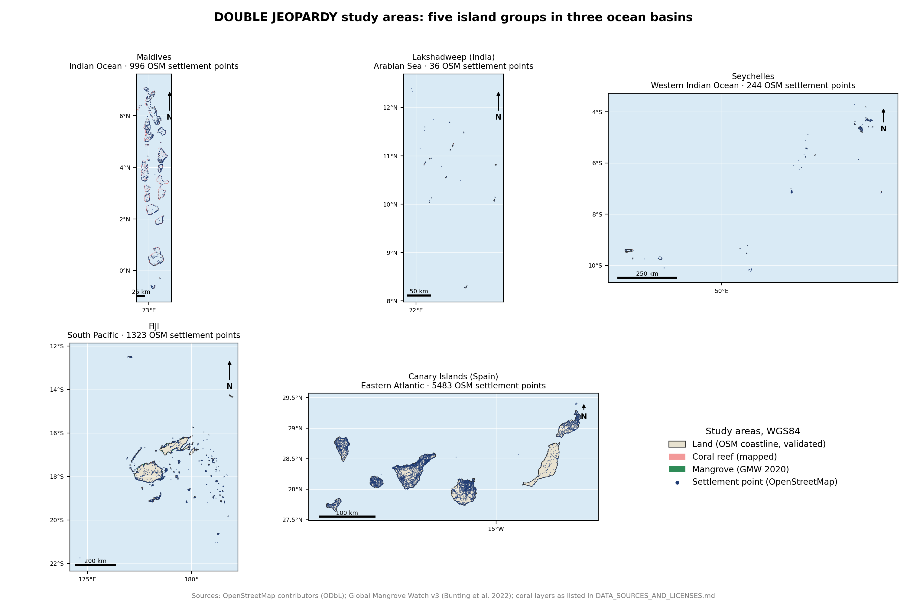

**Figure 1.** The five study areas, drawn from the project's own data: land from OpenStreetMap coastlines (validated against official land areas, see Section 6.3), mapped coral reefs, Global Mangrove Watch 2020 mangroves, and OpenStreetMap named places.

### 3.2 Data Sources

| Variable | Source | Temporal coverage |
|---|---|---|
| Bare earth elevation (main) | DeltaDTM v1.1 (Pronk et al., 2024), 1 arc second | Static |
| Surface elevation (comparison) | Copernicus DEM GLO-30 | Static |
| Population | WorldPop 2020, 100 m | 2020 |
| Named places | OpenStreetMap | Current |
| Mangrove extent | Global Mangrove Watch v3 (Bunting et al., 2022) | 1996, 2010, 2020 |
| Reef heat stress | NOAA Coral Reef Watch Degree Heating Week v3.1, 5 km | 1996–2020, monthly sampled |
| Reef extent | UNEP-WCMC warm water coral reefs; OpenStreetMap reef features | Current |
| Protected areas | World Database on Protected Areas, June 2026 | Current |
| Built up change | Sentinel-2 L2A (NDBI) | 2016 vs. 2024 |

Full citations and licences are in `DATA_SOURCES_AND_LICENSES.md`.

### 3.3 Physical Exposure

**Elevation.** The main elevation model is DeltaDTM v1.1, a bare earth version of Copernicus GLO-30 in which vegetation and buildings have been removed using ICESat-2 and GEDI lidar (Pronk et al., 2024). DeltaDTM is a coastal product, intended for land below about 10 m; its values are clipped at 30 m, and cells outside its coastal mask are empty. I took the tiles from the Earth Engine community catalogue copy of DeltaDTM v1.1, exported on the same 1 arc second grid as Copernicus GLO-30. Copernicus GLO-30, a surface model, is kept as a comparison, and every exposure figure is reported on both.

Two rules handle the edges of DeltaDTM's coverage. Where DeltaDTM is empty and Copernicus reads above 10 m, the point is treated as above 10 m. Where DeltaDTM is empty and Copernicus reads 10 m or less, the point has no usable bare-earth height and is left out of the DeltaDTM figure (Section 4.6 shows this does not change the comparison). Where Copernicus reads above 30 m, I do not use DeltaDTM at all. On several small, forested granite islands in Seychelles (Grande Sœur, Petite Sœur, Île Marianne), DeltaDTM reads close to 0 m under a Copernicus surface of 30–76 m; a 30 m tree canopy is not plausible there, so those cells are treated as high terrain. Heights in both models are above the EGM2008 geoid, which I use as an approximation of mean sea level.

**People (main measure).** I resampled elevation to the WorldPop 2020 100 m grid, clipped to each island's validated boundary polygon (Section 6.3), and counted the people on cells at or below 1 m. People on cells with no usable elevation are excluded from both numerator and denominator and reported (between 0.2% and 2.2% of each island group's population).

**Named places (second measure).** I also sampled elevation at every OpenStreetMap place point. On these islands most of these points are not villages but names of islands and islets, and some are labels for whole atolls placed in open water. A point in water is moved to the nearest land cell within 60 m; if there is none, it is left out and reported, not counted as safe. This measure shows where mapped places sit, including uninhabited and resort islets, so it answers a different question from the population measure.

**Same elevation rules in every analysis.** The three analyses read elevation from different units (a point, a 100 m population cell, a building), so the code differs, but the rules are the same:

| Case | Named places (point) | People (100 m cell) | Buildings (point) |
|---|---|---|---|
| NoData, NaN or values ≤ −1000 m | excluded | excluded | excluded |
| Exact 0.0 m (flattened water surface) | median of land pixels within about 60 m, else excluded | dropped before averaging the cell | treated as empty |
| DeltaDTM empty, Copernicus > 10 m | Copernicus height (above 10 m) | Copernicus height | Copernicus height |
| DeltaDTM empty, Copernicus ≤ 10 m | excluded | excluded | excluded |
| Copernicus > 30 m | Copernicus height (high terrain) | Copernicus height | Copernicus height |
| DeltaDTM below 0 m | kept | kept | kept; also reported without (Section 4.8) |

**Threshold.** 1 m is a threshold on elevation, not a flood model; tides, surge, waves and hydraulic connection to the sea are not modelled. I repeated the named place measure at 0.5 m and 1.5 m (Section 4.6).

### 3.4 Mangrove Extent

I measured mangrove area at 1996, 2010 and 2020 in an equal area projection (EPSG:6933), using Global Mangrove Watch v3. These epochs are derived by change detection from a 2010 baseline (Bunting et al., 2022), so they are not three fully independent classifications, and very small mangrove areas (Maldives, about 1 km²) are close to what the product can resolve. Area, not polygon count, is the measure, since polygon counts change with how a classifier segments an image.

### 3.5 Reef Heat Stress

Degree Heating Weeks (DHW) measure accumulated heat stress, the main driver of bleaching, not reef condition itself. For each reef island I took every 5 km NOAA Coral Reef Watch cell that overlaps mapped reef and averaged DHW across those cells at each time step, from 1996 to 2020, sampled about every 30 days. The Canary Islands have no mapped reef; their series is one offshore 5 km cell, kept only as an Atlantic comparison.

I compared mean DHW in 1996–2000 with 2016–2020, and tested for a monotonic trend with a seasonal Mann-Kendall test on calendar month means (300 months). DHW is a 12 week running sum, so neighbouring months are not independent, and the ordinary seasonal test (Hirsch et al., 1982) treats them as if they were. I therefore report the version corrected for serial correlation (Hirsch & Slack, 1984; Hipel & McLeod, 1994), as implemented in pyMannKendall (Hussain & Mahmud, 2019), and give the uncorrected p values alongside for comparison. An independent implementation of both tests in NumPy reproduces the uncorrected p values exactly and the corrected ones to within 0.005 (`scripts/validation/coral_trend_check.py`).

### 3.6 Compound Score

Two inputs, each scaled 0–1 across the 5 island groups with min–max scaling and averaged with equal weight:

- **Exposure:** share of people at or below 1 m on DeltaDTM (Section 3.3).
- **Reef heat stress:** change in mean DHW over mapped reef, 1996–2000 to 2016–2020 (Section 3.5). The Canary Islands have no reef to buffer anything, so their reef input is set to 0 rather than taken from an offshore cell.

Mangroves are not an input; there is no measured decline to weight. I swept the exposure weight from 0 to 100% in steps of 1% and report where the top island changes.

This score covers exposure and one ecological stressor only. The standard vulnerability framework (Turner et al., 2003; IPCC assessment reports) also includes sensitivity and adaptive capacity: income, relocation options, insurance, early warning, disaster response. None of those are in this score. It is a descriptive ranking of two physical inputs within this sample, and min–max scaling means a score of 0 is the lowest in the sample, not an absence of risk.

### 3.7 Governance

I measured the share of a 10 km zone around each island's coastline (land and sea) that lies inside a WDPA protected area, after merging overlapping sites so no area is counted twice, and separately the share under strict IUCN categories Ia–IV. Lakshadweep has no record in the WDPA extract, so it is left out instead of being set to zero. I compare coverage with the compound score using Pearson's r with a Fisher z 95% interval, Spearman's ρ and leave one out values. With n = 4 this can only describe the sample.

### 3.8 Built Up Change (supplementary)

For the 3 islands with mangroves I compared Sentinel-2 NDBI between cloud masked 2016 and 2024 composites, on land pixels only, and on land within 1 km of mapped mangroves and reefs, with 95% block bootstrap intervals. Each island is represented by one 1,024 × 1,024 pixel window, not the whole country: the Malé area of the Maldives (72.9–73.6° E, 3.0–4.5° N), Mahé in Seychelles (55.3–55.6° E, 4.5–4.8° S) and western Viti Levu in Fiji (177.2–178.0° E, 17.5–18.3° S). This serves as context and is not tested as a hypothesis.

### 3.9 Coastal Setbacks and Low-Lying Buildings

The protected area measure in Section 3.7 asks whether conservation designations follow risk. A setback asks a sharper question, because it is the one coastal instrument that decides directly where people may build. I classify the coastal instruments documented in this paper with Hood's (1983) NATO scheme (Nodality, Authority, Treasure, Organisation) and then test the Authority instrument that all five settings could in principle use, a minimum building distance from the shoreline.

| Island group | Setback for buildings (Authority) | Other coastal instruments in this paper | Legal status of the setback |
|---|---|---|---|
| Canary Islands | 100 m protection easement; 20 m on land already urban in 1988 | Natura 2000 sites and national parks (Authority) | Ley 22/1988 de Costas, art. 23 and Transitional Provision 3 |
| Seychelles | 25 m from the landward side of the high water mark; 10 m with permission where topography justifies it | Marine Spatial Plan protected areas (Authority), financed through a 2016 debt for nature swap (Treasure) | Physical Planning (Development and Subdivision of Parcels) Regulations 2023, S.I. 91 of 2023, reg. 13 |
| Lakshadweep | 20 m no development zone | none in WDPA | Island Coastal Regulation Zone Notification 2019 (width from secondary sources; primary text not verified) |
| Maldives | none found for inhabited islands; 5 m from the vegetation line on islands leased for tourism | protected areas and UNESCO-MAB zones (Authority) | Regulation on the Protection and Conservation of Environment in the Tourism Industry, cl. 2.10 |
| Fiji | none found | locally managed marine areas (Organisation, community co-management) | – |

No separate Nodality instrument, such as public hazard mapping, is analysed; the national coastal plan coded in Section 3.10 is partly informational. The Seychelles debt-for-nature swap is a Treasure instrument but is not among the coded items. The table lists only instruments this paper documents and is not a full inventory of each country's coastal policy, so the NATO classification describes the instruments rather than comparing instrument mixes.

**Case selection and comparability.** The five island groups were chosen for ecological and geological range (Section 3.1), and the policy comparison was added later. They are read as a structured, focused comparison of five jurisdictions that face the same hazard under different institutions (George & Bennett, 2005); the design does not control for the other ways in which the cases differ.

| | Maldives | Lakshadweep | Seychelles | Fiji | Canary Islands |
|---|---|---|---|---|---|
| Status | Sovereign state | Union Territory of India | Sovereign state | Sovereign state | Autonomous community of Spain; EU outermost region |
| Who sets the coastal siting rule | National government | National ministry in New Delhi | National government | National government | Spanish State; administration partly regional since 2023 |
| Island type | Coral atolls | Coral atolls | Granitic and coral islands | Large volcanic islands with fringing reef | High volcanic islands, no reef |
| People in study area | 489,808 | 66,181 | 93,271 | 884,821 | 2,077,968 |
| Setback reference line | Vegetation line (resort islands only) | High tide line | High water mark | – | Inner limit of the maritime-terrestrial public domain |

The Maldives–Lakshadweep pair is the closest the sample comes to a most similar comparison: Indian Ocean coral atolls of similar height, and Minicoy in Lakshadweep speaks Mahl, a dialect of Dhivehi. The pair also differs in more than the setback. The Maldives has about seven times the population, a capital built partly on reclaimed land (Malé and Hulhumalé) and a resort economy, while Lakshadweep is administered from New Delhi and restricts entry by permit. So the pair cannot isolate the effect of having a setback, though it can show whether a 20 m rule changes how well a distance rule fits the low buildings on an atoll.

For buildings I used footprints from Overture Maps (release 2026-08-19.0), which merges OpenStreetMap, Google Open Buildings, Microsoft ML Buildings, Esri Community Maps and, for Spain, the Instituto Geográfico Nacional. The 100 m WorldPop grid is too coarse for a 20–25 m rule. Fiji's extract contains OpenStreetMap buildings only. For each footprint I took a representative point inside it, sampled elevation with the same rule as Section 3.3 (DeltaDTM, with Copernicus where DeltaDTM is empty and Copernicus exceeds 10 m, or where Copernicus exceeds 30 m), and measured its distance to the shoreline, taken as the edge of the validated island polygons (Section 6.3) densified to 5 m. Buildings more than 50 m seaward of the polygons or without usable elevation are excluded and counted. The main measure is the share of buildings at or below 1 m that stand within each statutory setback, set next to the share within the same widths (20, 25 and 100 m) on every island. Many existing buildings predate the rules, so this shows whether a rule is drawn where low buildings stand and says nothing about compliance. Since a setback governs where new buildings may go, I also measure the share of low **land** within each width, independent of what has already been built (`scripts/analysis/setback_lowland_coverage.py`). A regular grid of points (30 m on the atolls and Seychelles, 60 m on Fiji and the Canary Islands) is laid over each island polygon, elevation is sampled with the same rule, and the share of points at or below 1 m within 20, 25 and 100 m of the shoreline is reported, for all low land and for open low land with no building point within 20 m. Points without a usable elevation are left out: 27% of Maldivian land points, where DeltaDTM is empty and Copernicus reads 10 m or less, and under 7% elsewhere. Because 45% of the low buildings in Seychelles and 39% in Fiji sit on cells below 0 m, which are DeltaDTM artefacts rather than ground below sea level, every number is also reported without them (`scripts/analysis/setback_calibration.py`).

### 3.10 Policy Density, Intensity and Change Over Time

Section 3.9 tests one instrument. To compare the five governments' coastal rules as a whole, I coded them by hand from the legal texts and official summaries (`data/policy_coding/`, with a codebook). Following Knill, Schulze and Tosun (2012), I separate policy density, the number of instrument types in force, from policy intensity, how demanding an instrument is.

- **Density** counts six instrument types that bear on building near the shore: a statutory building setback, statutory coastal zones, an environmental impact assessment law covering coastal projects, a national coastal plan, a body with a coast-specific mandate, and a climate framework law. Each is 1 if found in force in October 2026 and 0 if not found.
- **Intensity** is the setback width on built-up land and on other coastal land, averaged and divided by 100 m (Spain's easement, the widest in the sample). Governments with no setback score 0.
- **Change over time** is a dated list of 23 changes to coastal and environmental rules from 1988 to 2025, each coded as expansion, dismantling (an instrument removed, relaxed or exempted; Bauer et al., 2012), reallocation of competence between levels of government, reform or implementation.

To describe the political setting of each change, I add the V-Dem electoral democracy index (0 to 1; Coppedge et al., 2026, via Our World in Data) for the national government in the year of the change. With five countries this is descriptive only. Every coded value carries its legal basis, a source and a verification level (primary text, official summary, secondary source, or not found). Density and intensity are policy outputs in the sense of Knill, Schulze and Tosun (2012). The coverage measures of Section 4.8 sit next to them only to show whether counting instruments says anything about how well the setback fits the low land. Four of the six density items are Authority instruments (codebook), so density mainly compares how much Authority each government uses. Intensity is width only: it does not capture what a zone allows or forbids, or exceptions such as Seychelles' 10 m with permission. The coding and figures are produced by `scripts/analysis/coastal_policy_coding.py`.

## 4. Results

### 4.1 Physical Exposure

11.82% of people in the Maldives live on land at or below 1 m on the bare earth model. 6.40% in Lakshadweep. 2.07% in Seychelles. 0.28% in Fiji. 0.19% in the Canary Islands.

| Island group | People ≤ 1 m, DeltaDTM | People ≤ 1 m, Copernicus | People at or below 1 m (DeltaDTM) | Named places ≤ 1 m, DeltaDTM | Named places ≤ 1 m, Copernicus |
|---|---:|---:|---:|---:|---:|
| Maldives | 11.82% | 8.88% | 57,889 of 489,808 | 28.8% (235 of 817) | 4.4% |
| Lakshadweep | 6.40% | 0.79% | 4,238 of 66,181 | 3.8% (1 of 26) | 0.0% |
| Seychelles | 2.07% | 0.43% | 1,933 of 93,271 | 24.7% (38 of 154) | 9.9% |
| Fiji | 0.28% | 0.21% | 2,460 of 884,821 | 4.7% (56 of 1,180) | 3.6% |
| Canary Islands | 0.19% | 0.15% | 3,946 of 2,077,968 | 0.26% (14 of 5,470) | 0.18% |

Named places: share of places with a usable elevation. Usable coverage is 82.0% of points in the Maldives, 63.1% in Seychelles and 72.2% in Lakshadweep, where many points are labels in open water; 89% or more elsewhere.

The bare earth model raises every figure, and by very different amounts. The Maldives rise by a third, from 8.88% to 11.82%. Lakshadweep rises eightfold, from 0.79% to 6.40%, and Seychelles nearly fivefold, from 0.43% to 2.07%. On the surface model Lakshadweep and Seychelles are close; on bare earth Lakshadweep is three times higher. These are forested coral islands where the surface model reads the top of the palm canopy as ground.

  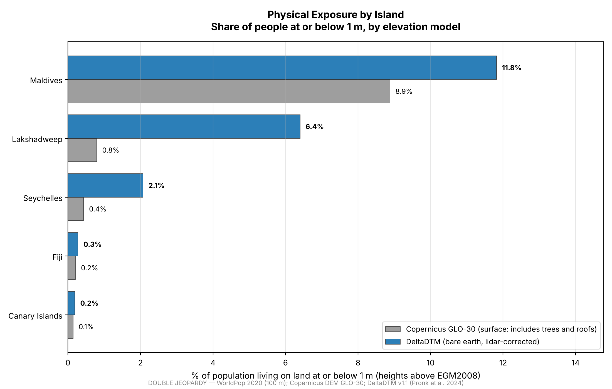

**Figure 2.** Share of people living on land at or below 1 m, by elevation model. Grey: Copernicus GLO-30 (surface, including trees and roofs). Blue: DeltaDTM v1.1 (bare earth). Heights above EGM2008.

Counting named places gives a different picture. By people, the Maldives lead clearly. By named places, the Maldives (28.8%) and Seychelles (24.7%) are close, because Seychelles has many small, low coral islets with few or no residents, while most of its people live on the high granitic islands. Lakshadweep is the reverse, with few named places but a relatively large share of its people on low ground. Neither measure is wrong; they answer different questions. I use people as the main measure because the question is who lives on low land.

  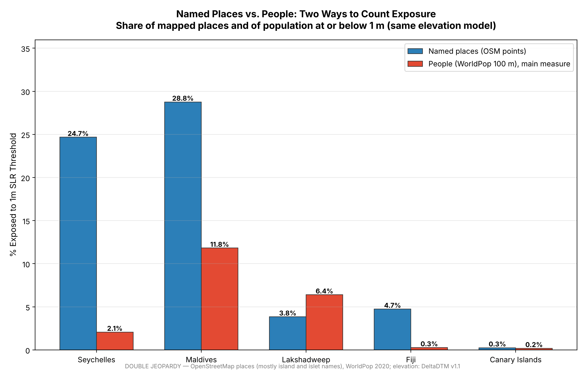

**Figure 3.** Share of named places (OpenStreetMap points, mostly island and islet names) and of people at or below 1 m, both on DeltaDTM.

### 4.2 Mangrove Extent: No Measurable Decline

Maldives: 0.97 km² at all 3 time points. Seychelles: 3.83–3.84 km². Fiji: 485.7 km² in 1996 and 488.4 km² in 2020, a net increase of 0.6%. Area stayed essentially stable on all 3 islands, so H2 is not supported. On the atolls, mangrove patches are close to the product's 25 m pixel size, so small losses there may not be detectable.

  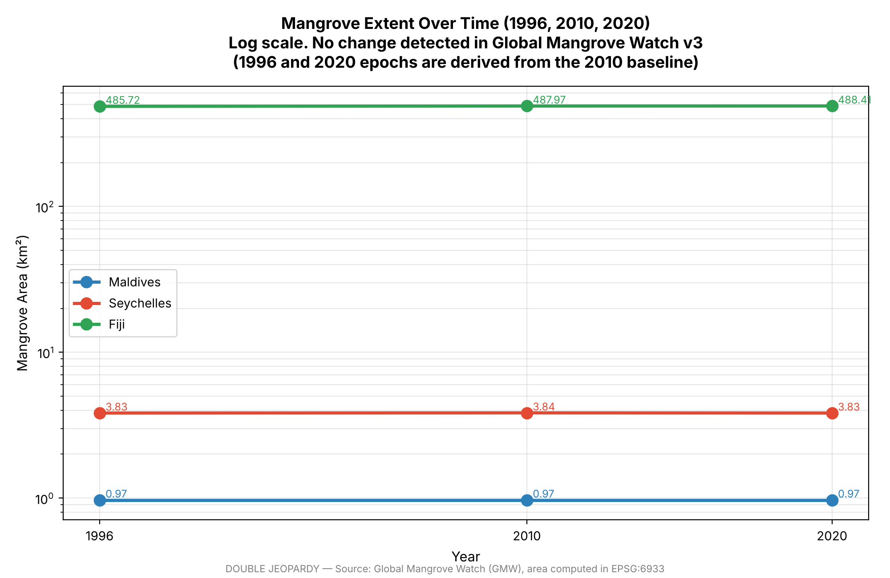

**Figure 4.** Mangrove extent (km², log scale) at 1996, 2010 and 2020 for the 3 islands where mangroves are present.

### 4.3 Reef Heat Stress: A Rise, Not Yet a Distinguishable Trend

Mean DHW over mapped reef was higher in 2016–2020 than in 1996–2000 on all 4 reef islands: Seychelles +0.52 °C-weeks, Fiji +0.29, Maldives +0.07, Lakshadweep +0.05. The highest values on the reef cell mean were 8.0 °C-weeks in Seychelles and 7.7 in Fiji, both close to the 8 °C-week level associated with widespread bleaching and mortality. The offshore Canary Islands cell shows a small decline (−0.05).

| Island group | Change, 1996–2000 to 2016–2020 (°C-weeks) | Max DHW | Seasonal MK p, corrected | Seasonal MK p, uncorrected |
|---|---:|---:|---:|---:|
| Seychelles | +0.52 | 8.03 | 0.14 | 0.002 |
| Fiji | +0.29 | 7.69 | 0.55 | 0.25 |
| Maldives | +0.07 | 6.25 | 0.31 | 0.049 |
| Lakshadweep | +0.05 | 3.86 | 0.90 | 0.81 |
| Canary Islands (one offshore cell) | −0.05 | 12.46 | 0.55 | 0.30 |

Both columns test the same 300 monthly means; only the correction differs. No monotonic trend is significant at the 5% level once serial correlation is accounted for. Without the correction, Seychelles (p = 0.002) and the Maldives (p = 0.049) would appear significant. That gap is the point: DHW accumulates over 12 weeks, so a single warm year produces a run of high monthly values, and a test that counts each month as independent evidence overstates how much information 25 years contain. H1 is partly supported. Heat stress over reef rose everywhere, but over this record the rise cannot be separated from serially correlated variability. The record ends in 2020, before the fourth global bleaching event that began in 2023 (NOAA, 2024).

  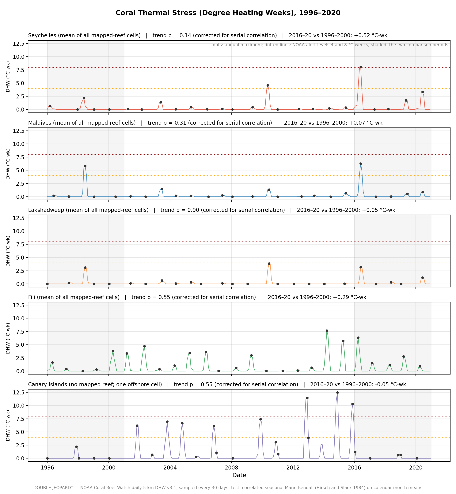

**Figure 5.** Mean Degree Heating Weeks over mapped reef cells per island, 1996–2020 (Canary Islands: one offshore cell, no mapped reef), with the 1996–2000 and 2016–2020 means and the 4 and 8 °C-week alert levels. Panel labels give the seasonal Mann-Kendall p value corrected for serial correlation.

### 4.4 Compound Score: The Top Depends on the Weighting

Seychelles 0.581. Maldives 0.563. Lakshadweep 0.320. Fiji 0.282. Canary Islands 0.000.

The two inputs point to different islands. The Maldives have by far the highest exposure (11.82% of people) but almost no change in reef heat stress (+0.07). Seychelles has the largest rise in reef heat stress (+0.52) but much lower exposure (2.07%). At equal weights Seychelles is narrowly ahead, but the gap of 0.02 is small next to the choices behind it, and I read the top two as a near tie.

  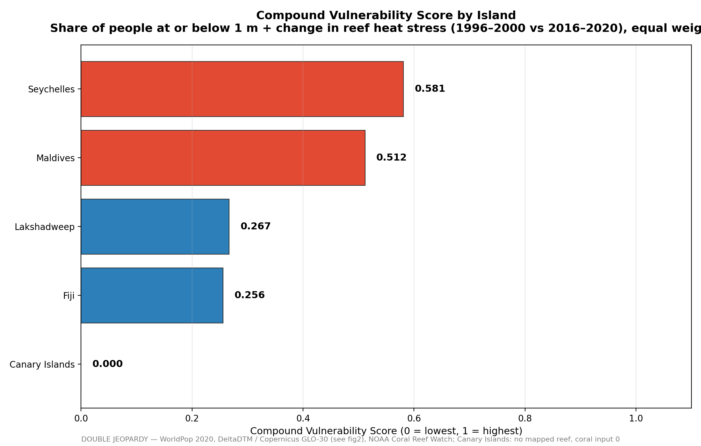

**Figure 6.** Compound score at equal weights: share of people at or below 1 m (DeltaDTM) and change in mean DHW over mapped reef, each scaled 0–1.

### 4.5 Governance: Protection Does Not Track Risk in This Sample

| Island group | Coastal zone protected | Strict (IUCN Ia–IV) | Compound score |
|---|---:|---:|---:|
| Seychelles | 71.4% | 9.9% | 0.581 |
| Canary Islands | 50.4% | 10.8% | 0.000 |
| Fiji | 12.2% | 2.2% | 0.282 |
| Maldives | 1.3% | 0.4% | 0.563 |
| Lakshadweep | no WDPA record | — | 0.320 |

Coverage and the compound score are unrelated across the 4 island groups (r = −0.10, 95% interval −0.97 to 0.95; Spearman ρ = 0.20). The two islands at the top of the compound score sit at opposite ends of protection: Seychelles at 71.4% and the Maldives at 1.3%. Removing Seychelles alone moves r to −0.95, which shows how little 4 points can say. H3 is not supported, and with n = 4 it could not have been confirmed either way.

Coverage seems to follow the instruments each country has used more than the risk it faces. Seychelles' coverage comes largely from its Marine Spatial Plan, which designated more than 30% of its EEZ in 2020 following a 2016 debt for nature swap; the Canary Islands' from Natura 2000 sites and national parks; Fiji's from locally managed marine areas (102 of its 126 WDPA records). These are different instruments with different strengths, and coverage alone says nothing about how well any of them is managed. Definitions also differ: 25 of the Maldives' 93 WDPA records are UNESCO-MAB Biosphere Reserve zones, which Protected Planet does not count towards its own coverage statistics; they are included here as they appear in WDPA.

  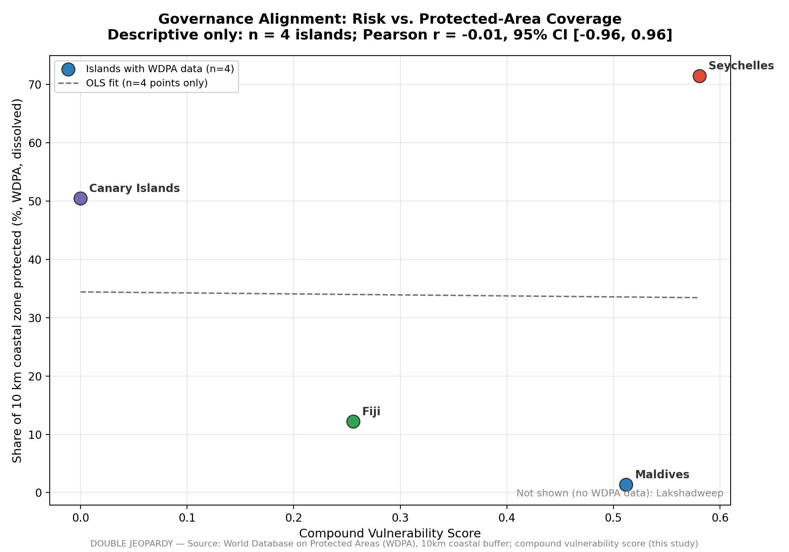

**Figure 7.** Share of the 10 km coastal zone inside a protected area (WDPA June 2026, overlaps merged) against the compound score. n = 4; Lakshadweep has no WDPA record. Descriptive only.

### 4.6 Sensitivity Checks

* **Weighting.** Sweeping the exposure weight from 0 to 100%, Seychelles is top up to 51% and the Maldives from 52% upward (Figure 8). The equal weighting I use sits close to that crossover, which is another reason to read the top two as a near tie.

* **Elevation model.** Section 4.1 reports every figure on both models. For people the order is the same on both, but the gaps change: Lakshadweep goes from under a tenth of the Maldives' share to more than half. For named places the leader changes, from Seychelles on the surface model (9.9% against 4.4%) to the Maldives on bare earth (28.8% against 24.7%). The two models do not use quite the same places, because points with no DeltaDTM value and a Copernicus height of 10 m or less are left out of the bare-earth figure (Seychelles 154 of 162 points, Fiji 1,180 of 1,269). On the 154 Seychelles points both models share, Copernicus gives 8.4% against the Maldives' 4.4%, so the change of leader holds. No other choice in the study moves the numbers as much.

* **Water level.** Share of named places at 0.5 m, 1 m and 1.5 m on DeltaDTM:

| Island group | 0.5 m | 1.0 m | 1.5 m |
|---|---:|---:|---:|
| Maldives | 15.3% | 28.8% | 51.0% |
| Seychelles | 14.3% | 24.7% | 28.6% |
| Fiji | 3.2% | 4.7% | 8.8% |
| Lakshadweep | 3.8% | 3.8% | 15.4% |
| Canary Islands | 0.13% | 0.26% | 0.35% |

  On bare earth the atolls are very sensitive to the chosen level. Half of the Maldives' named places sit at or below 1.5 m.

* **Reef heat stress series.** With one 5 km cell per island instead of the reef cell mean, the corrected p values are 0.14 (Maldives) and 0.13 (Seychelles); with a ±0.15° box around that cell, 0.09 and 0.13. No version reaches 0.05 once serial correlation is accounted for.

* **Governance.** Leave one out r ranges from −0.95 (without Seychelles) to 0.42 (without the Canary Islands). The earlier land area ratio, kept for comparison, gives r = 0.57 (p = 0.43).

  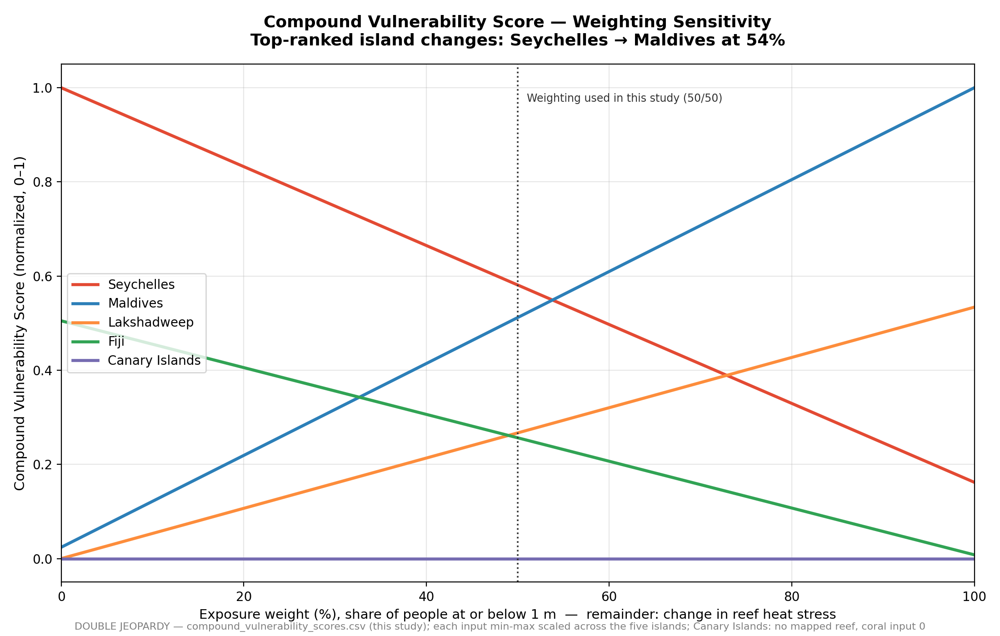

**Figure 8.** Compound score for each island as the exposure weight is swept from 0 to 100%. The top island changes from Seychelles to the Maldives at an exposure weight of 52%.

### 4.7 Built Up Change on Land (supplementary)

On land pixels only, NDBI rose in the Maldives (+0.055, 95% interval 0.040 to 0.072) and did not rise in Seychelles (−0.001, −0.004 to 0.001) or Fiji (−0.011, −0.013 to −0.009). On land within 1 km of mapped mangroves and reefs, the Maldives again rose (+0.053), Seychelles fell slightly (−0.009) and Fiji rose slightly (+0.008, 0.002 to 0.014). Only the Maldives shows a clear rise, concentrated around the Malé urban area. Part of it may be newly reclaimed land. Much of Hulhumalé Phase 2 was reclaimed from the lagoon between 2015 and 2019, and the current OpenStreetMap coastline used to define land includes it.

### 4.8 Setback Width Against Where Low-Lying Buildings Stand

| Island group | Buildings analysed | At or below 1 m | Statutory setback | Low buildings within the statutory setback | Low buildings within 20 m (same width everywhere) | Median distance of low buildings to shore | Distance covering 90% of low buildings |
|---|---:|---:|---|---:|---:|---:|---:|
| Maldives | 114,884 | 13.4% (15,392) | none for inhabited islands | no setback | 5.2% | 92 m | 225 m |
| Lakshadweep | 9,434 | 4.7% (444) | 20 m | 6.8% | 6.8% | 80 m | 345 m |
| Seychelles | 52,534 | 4.6% (2,440) | 25 m | 8.0% | 5.6% | 136 m | 427 m |
| Fiji | 277,470 | 0.5% (1,397) | none | no setback | 6.9% | 95 m | 463 m |
| Canary Islands | 880,287 | 0.02% (192) | 100 m (20 m urban) | 84.9% | 51.6% | 19 m | 122 m |

The building count gives the same order as the population count in Section 4.1 (Maldives 13.4% of buildings against 11.8% of people; Fiji 0.5% against 0.28%), except that Seychelles rises from 2.1% of people to 4.6% of buildings; without the sub-zero cells it is 2.6%. Excluding those cells moves the share of low buildings within the setback by less than three points anywhere (Seychelles 5.7%, Lakshadweep 4.3%).

In Lakshadweep and Seychelles the setbacks cover 6.8% and 8.0% of the low buildings. The Maldives and Fiji have no setback for inhabited land; at the same 20 m width a rule would cover 5.2% and 6.9% of their low buildings, about the same as Lakshadweep's 6.8% with a rule in force. On these islands, where the low land lies decides how much a distance rule can cover, and the Maldives–Lakshadweep pair shows the same under two legal regimes. The Canary Islands differ in geography more than in law. Their 192 low buildings, out of 880,287, are a thin beachfront and port strip, half of them within 19 m of the shore, and the 100 m Ley de Costas line covers 85% of them, or 52% if the 20 m rule for land already urban in 1988 applies to all. Many sit on port quays, where the coastal easement may apply differently, and distances run to the island outline rather than the inner limit of the public domain. The Canary figure is therefore the least certain in the table and is best read as a geographic contrast.

A longer setback would not close the gap on the atolls. Applying the Spanish 100 m line to the Maldives would cover 54% of the low buildings and would also place 39% of all buildings inside the setback, on islands that are often only a few hundred metres wide. Most of an atoll's land is low, so distance from the shore is a weak guide to which buildings are at risk.

**Low land rather than buildings.**

| Island group | Land at or below 1 m | Median distance to shore | Within 20 m | Within 25 m | Within 100 m |
|---|---:|---:|---:|---:|---:|
| Maldives | 34.1 km² | 59 m | 19.3% | 24.1% | 70.3% |
| Lakshadweep | 3.4 km² | 58 m | 21.8% | 26.3% | 69.6% |
| Seychelles | 9.3 km² | 65 m | 20.6% | 25.2% | 63.3% |
| Fiji | 67.4 km² | 317 m | 7.4% | 8.9% | 25.1% |
| Canary Islands | 6.3 km² | 22 m | 47.6% | 52.8% | 73.5% |

Measured on land, a 20–25 m setback on the atolls and Seychelles would cover about a fifth to a quarter of the ground at or below 1 m (Lakshadweep 21.8% within its 20 m zone, Seychelles 25.2% within its 25 m line), against 7–8% of the low buildings. So the strip nearest the shore is low, but existing buildings mostly stand further back from it; what that strip is used for is not measured here. The shares are again close with a rule (Lakshadweep 21.8%) and without one (Maldives 19.3% at 20 m), as expected for a measure taken from the land alone. On Fiji the low land lies well inland, along river plains (median 317 m from the shore, 7.4% within 20 m), and in the Canary Islands it is a narrow strip, half of it within 22 m of the shore and 74% within the 100 m line. For future siting, a distance rule on an atoll would protect a fifth of the low ground at 20–25 m and about two thirds at 100 m, and leave the rest to other instruments. Leaving out land with a building within 20 m moves these shares by at most 3.5 points.

  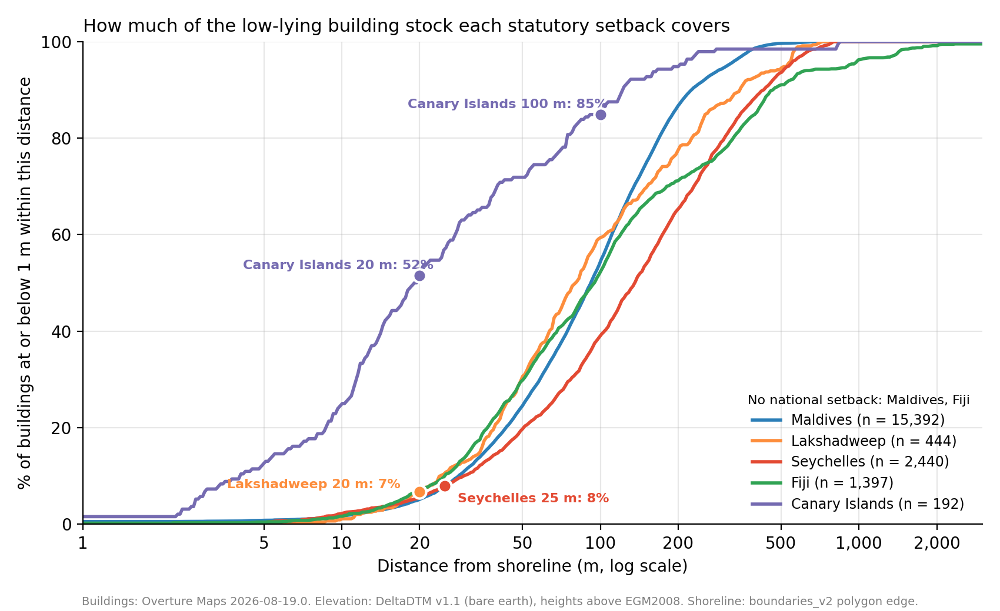

**Figure 9.** Share of buildings at or below 1 m (DeltaDTM) that stand within a given distance of the shoreline, with each statutory setback marked. Overture Maps buildings, release 2026-08-19.0; shoreline from the validated island polygons. The Maldives and Fiji have no national setback for inhabited land. Low buildings: Maldives 15,392, Lakshadweep 444, Seychelles 2,440, Fiji 1,397, Canary Islands 192, so the Canary curve is far less certain than the others.

  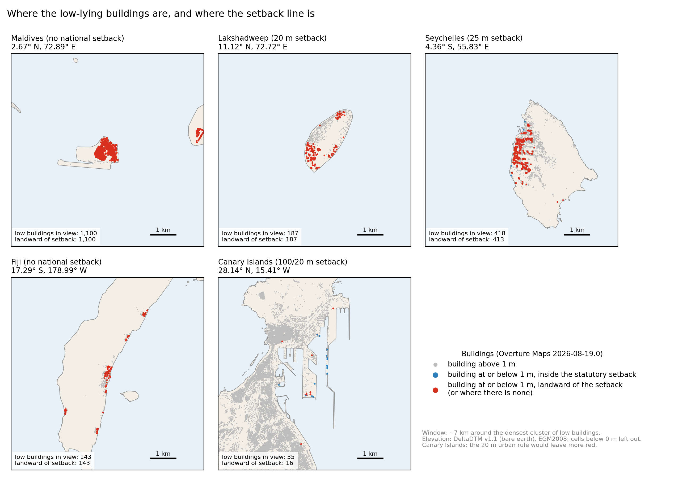

**Figure 10.** Close-ups of the densest cluster of buildings at or below 1 m in each island group (about 7 km across). Blue: low buildings inside the statutory setback; red: low buildings landward of it, or where there is none; grey: buildings above 1 m. In the Maldives window almost every building on the inhabited island is at or below 1 m; in the Canary Islands the low buildings are mostly on port quays. Cells below 0 m are left out.

### 4.9 Policy Outputs and Design Fit

| Jurisdiction | Density (of 6) | Setback on built-up land / elsewhere | Intensity | Low buildings within the statutory setback | Low buildings within 20 m (same width) | Width needed to cover 75% of low buildings | Changes coded (expansion / dismantling / reallocation) |
|---|---:|---|---:|---:|---:|---:|---|
| Canary Islands (Spain) | 6 | 20 m / 100 m | 0.60 | 84.9% | 51.6% | 62 m | 3 / 1 / 1 |
| Lakshadweep (India) | 5 | 20 m / 20 m | 0.20 | 6.8% | 6.8% | 187 m | 2 / 0 / 0 |
| Seychelles | 3 | 25 m / 25 m | 0.25 | 8.0% | 5.6% | 262 m | 3 / 0 / 0 |
| Fiji | 3 | none | 0 | no setback | 6.9% | 262 m | 3 / 0 / 0 |
| Maldives | 2 | none | 0 | no setback | 5.2% | 151 m | 4 / 2 / 1 |

Instrument counts and coverage do not line up. Lakshadweep has five of the six instrument types, including statutory coastal zones and a dedicated coastal authority, and its 20 m zone covers 6.8% of its low buildings; the Maldives, with two types and no setback, would cover 5.2% at the same width. Seychelles, with three types and a 25 m rule, covers 8.0%. The Canary Islands combine the most instruments, the widest setback and the highest coverage, but that is a single case whose coverage comes from its geography (Section 4.8). Covering three in four low buildings would take 151–262 m on the tropical islands, against 62 m in the Canary Islands.

Over time most coded changes added rules: 15 of 23 are expansions, from India's 1991 coastal regulation to Seychelles' 25 m setback in 2023. Three changes relaxed protection. Spain's 2013 reform extended existing coastal concessions to up to 75 years and removed 12 settlements from the public domain. In the Maldives, a 2024 amendment allowed reclamation in previously protected areas, and in 2025 the Environmental Protection Agency was replaced by an authority under ministerial control while some road, housing and resort works were exempted from impact assessment (the Maldivian changes rest on a civil society statement and are coded as secondary). Two changes moved competence between levels: the Maldives created island councils in 2010, and Spain transferred coastal management functions to the Canary Islands government in 2023, keeping fees and mandatory reports at State level. Lakshadweep is the opposite case. As a Union Territory, its coastal rules are set by notifications of the national ministry. The 2019 notification is coded as reform. Under the 2011 notification Lakshadweep was managed through Integrated Islands Management Plans rather than a fixed no development width, and I have not verified whether those plans restricted building near the shore more than the 20 m zone that replaced them; if they did, 2019 would count as dismantling. Two of the three dismantling events, both Maldivian, rest on one civil society statement.

Regime type does not sort the changes in this sample. Rules were added under governments across the whole range of the V-Dem electoral democracy index: the Maldives' 1993 environmental act at 0.16, Fiji's 2011 coastal framework at 0.13 under military rule, and Spain's 1988 Ley de Costas at 0.89. The three relaxations also came under different settings, Spain in 2013 at 0.88 and the Maldives in 2024–2025 at 0.58 and 0.56. The scores do differ between the governments in other respects. Seychelles rose from 0.59 to 0.76 between its 2016 impact assessment law and 2025 and adopted its setback along the way (2023, 0.73), while India's score fell from 0.67 when the 2011 island notification was issued to 0.43 in 2019, the year of the current one. Five countries are too few to say more than this.

  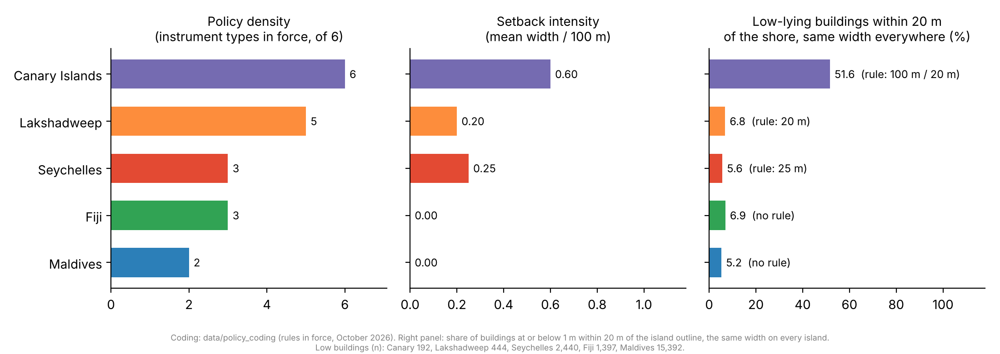

**Figure 11.** Policy density (instrument types in force, of 6), setback intensity (mean setback width divided by 100 m) and the share of buildings at or below 1 m within 20 m of the shore, the same width on every island, with each jurisdiction's statutory rule noted. Coding: `data/policy_coding/`, rules in force in October 2026.

  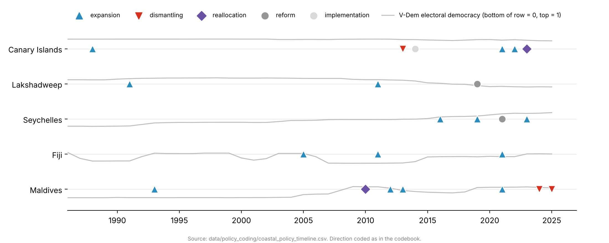

**Figure 12.** Dated changes to coastal and environmental rules, 1988–2025, coded by direction (expansion, dismantling, reallocation, reform, implementation). Grey line: V-Dem electoral democracy index of the national government (0 at the bottom of each row band, 1 at the top).

## 5. Discussion

On forested coral islands, a surface elevation model reads the tree canopy as ground, and the share of people at or below 1 m in Lakshadweep and Seychelles rises five to eightfold when the canopy is removed. The order by people stays the same, but the gaps change, and by named places the leader changes from Seychelles to the Maldives. This matches what Kulp and Strauss (2019) found at global scale. Any ranking of islands by exposure should name the elevation model behind it.

Whether places or people are counted matters too. Places put Seychelles level with the Maldives, while people put the Maldives far ahead and Lakshadweep second. Either is a reasonable choice, but since they order the islands differently, the choice needs to be stated.

The reefs and mangroves did not move together. Mangrove extent held steady on all 3 islands, in line with the slowdown in mangrove loss in the global record (Bunting et al., 2022). Reef heat stress went up everywhere, most in Seychelles and Fiji, as the bleaching literature would lead one to expect (Heron et al., 2016), but 25 years of a 12 week running sum are not enough to call it a monotonic trend once serial correlation is respected.

Putting exposure and reef heat stress into one score leaves no clear top island. The island with the most people on low land (the Maldives) is not the island whose reefs are warming fastest (Seychelles), and which one is "most vulnerable" depends on how much weight exposure carries. Because the order flips close to equal weights, I would not use this ranking on its own to decide where money goes.

Protection does not follow this risk in these 4 island groups either. Seychelles protects most of its coastal zone and the Maldives almost none, while both sit at the top of the compound score. The reasons seem to lie in how each country built up its protection, through a debt for nature swap and a marine spatial plan in one case and many small sites spread across the atolls in the other. Four cases are enough to describe this sample, but say little about protection policy in general.

The setback analysis looks at the same problem through building rules, with a much larger sample. The one Authority instrument that decides where people build fits the low-lying stock only in the Canary Islands, where Spain's 1988 rule was written for a mainland and high-island coast and low land is a beachfront strip. On the coral and granitic islands the median low building stands 80–136 m from the shore, and a distance rule of practical width covers only part of the low ground: 20–25 m reaches a fifth to a quarter of it, 100 m about two thirds. This is a problem of design, the unit in which the rule is written, and it would remain even if every rule were fully enforced. For adaptation policy on atolls, it points to instruments defined by height, such as minimum floor or ground levels, or raising land. In the Maldives–Lakshadweep pair, having a setback made no difference to the spatial fit (Section 4.8).

The policy coding shows why counting instruments is not enough. Counting instruments, Lakshadweep is the second most regulated coast in the sample, yet its 20 m zone covers about the same share of low buildings as the same width would in the Maldives, which has none of the coastal instruments coded here except an impact assessment law and a climate act. A comparison that stopped at the statute book would rank Lakshadweep well ahead of the Maldives; measured against where the buildings stand, the two are close. Neither measure says how well the rules perform. That would need data on permits, compliance and enforcement, which this study does not have, and Daugbjerg (2022) shows that capacity in implementation can make up for weak instruments. Looking at the rules over time does not change this. Most rule changes since 1988 added instruments, but none of them changed the geometry of the setback on the tropical islands, and the two governments that relaxed coastal or environmental protection did so for different reasons, extending existing private use of the coast in Spain and speeding up development approvals in the Maldives.

## 6. Limitations

### 6.1 What Changed From Version 1

Version 1 of this study reported six results that were withdrawn on review. Each came from a measurement choice that is easy to make and hard to see.

- **"78.3% of Seychelles settlements at risk."** 188 of the 244 Seychelles points read −32767 m, the elevation raster's NoData value, and were counted as at or below 1 m; the raster was 99.97% NoData. On top of that, OpenStreetMap "settlement" points on these islands are mostly names of islands and islets, some placed in open water. The study now samples one shared elevation rule for every island (NoData and out of extent points can no longer count as at risk), moves points in water to land within 60 m or leaves them out, uses people as the main measure, and reports named places as a second measure.
- **A surface elevation model.** Version 1 used Copernicus GLO-30 only. On bare earth, exposure rises everywhere and the order changes (Section 4.1).
- **"Significant coral trends in the Maldives (p = 0.0046) and Seychelles (p = 0.0069)."** These came from one 5 km cell per island and a seasonal test that treats months as independent. With the mean over mapped reef and the correction for serial correlation, no trend is significant (Section 4.3).
- **"Seychelles is top at every weighting."** Version 1's inputs (share of points and single cell DHW) both happened to be highest for Seychelles, so it scored 1.0 at every weight by construction, which was reported as robustness. With people and reef cell means, the inputs disagree and the ranking changes at 52%.
- **"Governance correlation r = 0.965, p = 0.035."** Overlapping protected areas were counted twice and coverage was divided by land area, which for small islands with large marine reserves gives ratios far above 1. As a share of the coastal zone, the relationship disappears (r = −0.10).
- **"Seychelles shows the strongest built up rise (+0.11)."** That was measured over bounding boxes that were mostly ocean. On land only, Seychelles shows no rise.

Earlier still, the Maldives and Lakshadweep elevation files had a coverage gap (99.99% of pixels read 0.0), and an incomplete boundary mask undercounted Lakshadweep's population; both were fixed earlier in the project. The Development Log records every step.

### 6.2 Elevation and Exposure

- Exposure is an elevation threshold with no tides, surge, waves or connectivity to the sea. Heights are measured from EGM2008, which approximates mean sea level, so exposure to the same water level at high tide would be higher.
- DeltaDTM's mean absolute error against airborne lidar is about 0.4–0.5 m (Pronk et al., 2024), large next to a 1 m threshold. Points near the threshold can be misclassified either way, so the comparison between models and islands matters more than any single percentage.
- DeltaDTM covers the coastal zone up to 10 m and is clipped at 30 m. The two rules in Section 3.3 handle cells above that range; the 30 m rule was added after DeltaDTM read forested granite hills in Seychelles as sea level. Some low forested ground elsewhere could still be misread in either direction.
- WorldPop is a modelled population surface, not a census, and at 100 m it can place people on a coastal cell whose mean elevation differs from where houses actually stand.
- Named place coverage is incomplete where many points are labels in open water: 82.0% of points are usable in the Maldives, 72.2% in Lakshadweep and 63.1% in Seychelles. Left out points are listed in the outputs and never counted as safe.

### 6.3 Boundaries

Island boundaries were rebuilt from OpenStreetMap coastlines (joined with shapely's polygonize) and, for Fiji, OSM's pre closed land polygons, then validated against independent land area figures (areas in the equal area projection EPSG:6933, overlapping polygons merged; `scripts/validation/boundary_area_validation.py`): Maldives 292.9 km² against 298 km² (World Bank, 2024), Seychelles 443.9 against 460, Fiji 18,819.3 against 18,270, Canary Islands 7,434.1 against about 7,446 (Instituto Canario de Estadística), Lakshadweep 30.8 against 32 (Lakshadweep administration), all within 4%.

### 6.4 Reef Heat Stress and Mangroves

- DHW measures heat stress. It does not record bleaching or coral cover, so a rise in DHW raises bleaching risk without showing reef loss.
- The series is sampled about every 30 days from a daily product, so short peaks can be missed. Monthly means smooth this further.
- The record ends in 2020, before the 2023 onward global bleaching event; a longer record could change the trend result.
- The Canary Islands have no mapped reef; their reef input is set to 0 in the compound score, and their offshore DHW series is shown only for comparison.
- Global Mangrove Watch epochs are derived from a 2010 baseline, and the atoll patches are close to the pixel size.

### 6.5 Sample Size and the Compound Score

- 5 island groups, and 4 for governance, describe this sample; they cannot establish general relationships. The governance correlation is reported with its interval and leave one out values to make that concrete.
- The compound score uses min–max scaling, equal weights and two inputs, and leaves out sensitivity and adaptive capacity. Lakshadweep's governance value is missing, so it is left out of the correlation.

### 6.6 Built Up Change

NDBI is an index of built-up surfaces that also responds to bare soil and dry vegetation. The comparison uses two composites with no time series in between, and covers only the 3 mangrove islands.

### 6.7 Setbacks and Buildings

- The shoreline is the edge of the island polygons, not the legal high water mark, vegetation line or inner edge of the Spanish public domain, so distances are approximate to some tens of metres. A 20–25 m rule against medians of 80–136 m is not sensitive to that, but individual buildings near the line are. The distances stand in for the legal reference line and cannot be used to test compliance.
- Distances are computed on a local flat approximation. Against ellipsoidal (Vincenty) distances for about 13,000 sampled buildings, the median difference is under 0.5 m on the four tropical island groups and 3.8 m in the Canary Islands, and fewer than 0.1% of sampled buildings change side of any setback line (`scripts/validation/setback_distance_check.py`).
- Elevation is sampled at one representative point per building, not across the whole footprint.
- DeltaDTM is a 30 m grid sampled at one point per building, with about 0.4–0.5 m vertical error against lidar; cells below 0 m are artefacts and are reported with and without.
- Building completeness differs: Fiji's extract is OpenStreetMap only, and 4,478 Maldivian buildings (3.6%, almost all OpenStreetMap; the largest cluster is in Addu Atoll) lie more than 50 m outside the island polygons and are excluded, which suggests some islands are missing or misplaced in the boundaries.
- The setback measured is the one written in national law. Local plans, permits and enforcement are not observed, and the Lakshadweep width rests on secondary sources.
- Coverage measures design fit. A setback governs future siting and many existing buildings predate it (Seychelles adopted its 25 m setback in 2023), so the share of existing buildings within a setback is not evidence of compliance or effectiveness, and the analysis says nothing about whether rules were broken. The low-land measure in Section 4.8 avoids this, but it is a grid sample at 30–60 m on a 30 m elevation model, and 27% of Maldivian land points have no usable bare-earth elevation.
- The Canary figure applies the 100 m width to every low building. Land already urban in 1988 (20 m) and port service zones may fall under other rules, and the legal reference line is the inner limit of the public domain rather than the coastline, so the 85% (52% under the 20 m rule) rests on 192 buildings and an approximate legal geometry.

### 6.8 Policy Coding

- The coding was done by one coder, so there is no inter-coder reliability check; every value has its source and verification level so it can be rechecked.
- "Not found" is coded 0 but is not proof that an instrument does not exist, especially for the Maldives and Fiji, where few legal texts are available in English.
- Density counts instruments equally; an impact assessment law and a climate framework law do not regulate building location as directly as a setback does. Four of the six items are Authority instruments and no Treasure instrument is coded.
- Search effort differed. Spanish and Indian texts were read in primary form more often; none of the Maldivian or Fijian items rests on a primary text, so their lower density may partly reflect source access.
- Width is not stringency. Spain's 100 m easement allows uses that a 20 m no development zone forbids, and exceptions such as Seychelles' 10 m with permission are not captured.
- The direction of the 2019 Lakshadweep change depends on how its 2011 island management plans compare with the 20 m zone, which I have not verified.
- The Lakshadweep setback width and the Maldivian changes of 2024–2025 rest on secondary sources.
- The timeline lists changes found in the sources used, not every amendment in each country.
- The V-Dem index describes the national government; for the Canary Islands and Lakshadweep it is Spain's and India's score, not a regional one.

## 7. Conclusion

On five island groups, the share of people living on land at or below 1 m depends strongly on the elevation model. On bare earth it is 11.8% in the Maldives and 6.4% in Lakshadweep, up from 8.9% and 0.8% on a surface model. Mangrove extent shows no decline. Every reef island saw more heat stress, most of all Seychelles, but over 1996–2020 the increase cannot be told apart from serially correlated variability. Combining exposure with reef heat stress gives a near tie between Seychelles and the Maldives that flips at 52% exposure weight, and protection of the coastal zone does not follow that ranking. Where coastal setbacks exist on the tropical island groups, they cover fewer than one in ten low-lying buildings, and the same width would cover about the same share on islands without a rule, because on atolls the low ground runs well inland from the shore. The rules are written in a unit that does not fit these islands, whatever their number: Lakshadweep, second in policy density, has the same spatial fit as the Maldives. On low land, a 20–25 m setback would cover a fifth to a quarter of the ground at or below 1 m on the atolls.

Most of what I learned is about method. The island that looked most vulnerable changed almost every time I changed an input, so I would not trust a single ranking of these islands without seeing how it was built. Anyone using an index like this to share out adaptation money should publish the choices behind it and how much the order moves with them, and on low, forested coasts should start from bare earth elevation.

## Declarations

### Author contributions

I am the sole author. I conceived the study, designed the methods, wrote the code, ran and checked the analysis, curated the data, wrote the paper and made the figures and maps (CRediT: Conceptualization, Methodology, Software, Validation, Formal analysis, Investigation, Data curation, Writing – original draft, Writing – review and editing, Visualization).

### Funding

The work was not funded by anyone; I paid its costs myself.

### Competing interests

I have no competing interests to declare.

### Ethics approval

No human participants, animals or personal data were involved, so ethical approval was not needed.

### Data availability

The study uses public data only: DeltaDTM v1.1 and the Copernicus DEM GLO-30 for elevation, WorldPop 2020 for population, OpenStreetMap for named places and coastlines, Overture Maps building footprints, NOAA Coral Reef Watch Degree Heating Weeks, Global Mangrove Watch v3, UNEP-WCMC reef and mangrove layers, the World Database on Protected Areas (June 2026 release), Sentinel-2, the V-Dem electoral democracy index (v16, via Our World in Data) and the published texts of national coastal and environmental laws. My own code and text are released under CC BY 4.0, but third-party data keep their original licences. WDPA extracts are not included because their terms do not allow public redistribution, and the UNEP-WCMC layers are for non-commercial research use. Full citations, licences and attribution texts are in `DATA_SOURCES_AND_LICENSES.md`. The code, processed data and figures are archived on Zenodo (DOI [10.5281/zenodo.23827474](https://doi.org/10.5281/zenodo.23827474)) and maintained on GitHub ([github.com/sakshimaske303-commits/DOUBLE-JEOPARDY](https://github.com/sakshimaske303-commits/DOUBLE-JEOPARDY)).

### Code availability and reproducibility

Nearly every reported number is written to a CSV in `data/`, and the figures and dashboard read those files; the mangrove areas and the common-point comparison in Section 4.6 are the exceptions. `scripts/run_all.py` re-runs the analysis, figures, maps and dashboard data and ends by reporting a complete or partial run. Large rasters and the building footprints are not committed; they are rebuilt with the included download scripts. The DeltaDTM tiles are exported with the Earth Engine Python API, which needs an Earth Engine project; the rest runs without it. Two scripts recompute key results independently: the coral trend p-values without the pyMannKendall library, and the setback distances on the WGS84 ellipsoid.

### Use of AI tools

The questions, the choice of islands and data, the methods, the decision to withdraw the six first-version results and the interpretation are mine. Within that work I used Claude (Anthropic), an AI assistant, in a supporting role. Its main job was cross-checking: comparing the exposure shares, reef heat-stress figures, compound scores and setback coverage quoted in the paper, executive summary, README and dashboard against the CSV files my scripts produce. I also asked it for help when one of my Python scripts broke or gave output I could not account for, and for the layout of the project web pages. The paper and other documents are my own writing; I used the assistant to flag wording that was unclear or overly technical, gaps where something seemed to be missing, and punctuation, and I decided which of those points to act on. It did not acquire or process the elevation, population, building, reef or mangrove data, and it did not run the analysis. I reviewed everything it suggested before using it, and the responsibility for the content is mine.

### Licence

Released under the Creative Commons Attribution 4.0 International licence (CC BY 4.0), with the third-party data exceptions above. Citation metadata are in `CITATION.cff`.

## References

Administration of Union Territory of Lakshadweep. (n.d.). About Lakshadweep. Government of India. [Read](https://lakshadweep.gov.in/about-lakshadweep/)

Bauer, M. W., Jordan, A., Green-Pedersen, C., & Héritier, A. (Eds.). (2012). *Dismantling Public Policy: Preferences, Strategies, and Effects*. Oxford University Press.

Bunting, P., Rosenqvist, A., Hilarides, L., Lucas, R. M., Thomas, N., Tadono, T., Worthington, T. A., Spalding, M., Murray, N. J., & Rebelo, L. M. (2022). Global Mangrove Extent Change 1996–2020: Global Mangrove Watch Version 3.0. *Remote Sensing*, 14(15), 3657. [https://doi.org/10.3390/rs14153657](https://doi.org/10.3390/rs14153657)

Coppedge, M., Gerring, J., Knutsen, C. H., Lindberg, S. I., Teorell, J., et al. (2026). V-Dem Country-Year Dataset v16. Varieties of Democracy (V-Dem) Project. Electoral democracy index as processed by Our World in Data. [Read](https://ourworldindata.org/grapher/electoral-democracy-index)

Daugbjerg, C. (2022). Against the odds: How policy capacity can compensate for weak instruments in promoting sustainable food. *Policy Sciences*, 55(3), 451–467. [https://doi.org/10.1007/s11077-022-09466-2](https://doi.org/10.1007/s11077-022-09466-2)

España. (1988). Ley 22/1988, de 28 de julio, de Costas. Boletín Oficial del Estado, 181, 29 July 1988. [Read](https://www.boe.es/buscar/act.php?id=BOE-A-1988-18762)

España. (2013). Ley 2/2013, de 29 de mayo, de protección y uso sostenible del litoral y de modificación de la Ley 22/1988, de 28 de julio, de Costas. Boletín Oficial del Estado. [Read](https://www.boe.es/eli/es/l/2013/05/29/2/con)

España. (2021). Ley 7/2021, de 20 de mayo, de cambio climático y transición energética. Boletín Oficial del Estado. [Read](https://www.boe.es/eli/es/l/2021/05/20/7/con)

European Space Agency / Copernicus Data Space Ecosystem. (2024). Copernicus DEM: Copernicus Digital Elevation Model Product Handbook (Issue 5.0). [Read](https://dataspace.copernicus.eu/sites/default/files/media/files/2024-06/geo1988-copernicusdem-spe-002_producthandbook_i5.0.pdf)

Ferrario, F., Beck, M. W., Storlazzi, C. D., Micheli, F., Shepard, C. C., & Airoldi, L. (2014). The effectiveness of coral reefs for coastal hazard risk reduction and adaptation. *Nature Communications*, 5, 3794. [https://doi.org/10.1038/ncomms4794](https://doi.org/10.1038/ncomms4794)

Fiji. (2021). Climate Change Act 2021. [Read](https://climate-laws.org/geographies/fiji/laws/climate-change-act-2021)

Government of India, Ministry of Environment and Forests. (2011). Island Protection Zone Notification, S.O. 20(E), 6 January 2011. [Read](https://icsf.net/wp-content/uploads/2011/01/219_island_protection_notification.pdf)

Government of India, Ministry of Environment, Forest and Climate Change. (2019). Island Coastal Regulation Zone Notification, 2019. [Read](https://leap.unep.org/en/countries/in/national-legislation/island-coastal-regulation-zone-notification-2019)

George, A. L., & Bennett, A. (2005). *Case Studies and Theory Development in the Social Sciences*. MIT Press.

Guannel, G., Arkema, K., Ruggiero, P., & Verutes, G. (2016). The Power of Three: Coral Reefs, Seagrasses and Mangroves Protect Coastal Regions and Increase Their Resilience. *PLOS ONE*, 11(7), e0158094. [https://doi.org/10.1371/journal.pone.0158094](https://doi.org/10.1371/journal.pone.0158094)

Hall, P. A. (1993). Policy paradigms, social learning, and the state: The case of economic policymaking in Britain. *Comparative Politics*, 25(3), 275–296.

Heron, S. F., Maynard, J. A., van Hooidonk, R., & Eakin, C. M. (2016). Warming Trends and Bleaching Stress of the World's Coral Reefs 1985–2012. *Scientific Reports*, 6, 38402. [https://doi.org/10.1038/srep38402](https://doi.org/10.1038/srep38402)

Hipel, K. W., & McLeod, A. I. (1994). *Time Series Modelling of Water Resources and Environmental Systems*. Elsevier.

Hirsch, R. M., & Slack, J. R. (1984). A nonparametric trend test for seasonal data with serial dependence. *Water Resources Research*, 20(6), 727–732. [https://doi.org/10.1029/WR020i006p00727](https://doi.org/10.1029/WR020i006p00727)

Hirsch, R. M., Slack, J. R., & Smith, R. A. (1982). Techniques of trend analysis for monthly water quality data. *Water Resources Research*, 18(1), 107–121. [https://doi.org/10.1029/WR018i001p00107](https://doi.org/10.1029/WR018i001p00107)

Hood, C. (1983). *The Tools of Government*. Macmillan.

Howlett, M. (2011). *Designing Public Policies: Principles and Instruments*. Routledge.

Hussain, M. M., & Mahmud, I. (2019). pyMannKendall: a python package for non parametric Mann Kendall family of trend tests. *Journal of Open Source Software*, 4(39), 1556. [https://doi.org/10.21105/joss.01556](https://doi.org/10.21105/joss.01556)

Instituto Canario de Estadística. (2026). Superficie. Islas y municipios de Canarias [Data set]. Gobierno de Canarias. [Read](https://www.gobiernodecanarias.org/istac/temas_estadisticos/territorioymedioambiente/territorioyusosdelsuelo/territorio/X00004A.html)

Knill, C., Schulze, K., & Tosun, J. (2012). Regulatory policy outputs and impacts: Exploring a complex relationship. *Regulation & Governance*, 6(4), 427–444.

Kulp, S. A., & Strauss, B. H. (2019). New elevation data triple estimates of global vulnerability to sea-level rise and coastal flooding. *Nature Communications*, 10, 4844. [https://doi.org/10.1038/s41467-019-12808-z](https://doi.org/10.1038/s41467-019-12808-z)

Maldives, Ministry of Tourism. (n.d.). Regulation on the Protection and Conservation of Environment in the Tourism Industry. [Read](https://old.mvlaw.gov.mv/pdf/gavaid/minTourism/11.pdf)

Ministerio de Política Territorial. (2022, August 30). Traspaso de funciones en materia de costas a la Comunidad Autónoma de Canarias [Press release]. [Read](https://www.mptfp.gob.es/dam/es/portal/prensa/notas_de_prensa/notas/2022/08/20220830CANARIAS.pdf)

National Oceanic and Atmospheric Administration, Coral Reef Watch. Daily 5km Satellite Coral Bleaching Heat Stress Degree Heating Week Product (Version 3.1) — Methodology. [Read](https://coralreefwatch.noaa.gov/product/5km/methodology.php)

National Oceanic and Atmospheric Administration. (2024, April 15). NOAA Confirms 4th Global Coral Bleaching Event. [Read](https://www.noaa.gov/news-release/noaa-confirms-4th-global-coral-bleaching-event)

Overture Maps Foundation. (2026). Overture Maps buildings theme, release 2026-08-19.0 [Data set]. [Read](https://docs.overturemaps.org/)

Pieraccini, M., Coppa, S., & De Lucia, G. A. (2017). Beyond marine paper parks? Regulation theory to assess and address environmental non-compliance. *Aquatic Conservation: Marine and Freshwater Ecosystems*, 27(1), 177–196. [https://doi.org/10.1002/aqc.2632](https://doi.org/10.1002/aqc.2632)

Pike, B. (2026). 10% Protected. 3% Effective. The Widening Gap We Can't Ignore. Marine Conservation Institute. [Read](https://marine-conservation.org/on-the-tide/ten-percent-protected-three-percent-effective/)

Pronk, M., Hooijer, A., Eilander, D., Haag, A., de Jong, T., Vousdoukas, M., Vernimmen, R., Ledoux, H., & Eleveld, M. (2024). DeltaDTM: A global coastal digital terrain model. *Scientific Data*, 11, 273. [https://doi.org/10.1038/s41597-024-03091-9](https://doi.org/10.1038/s41597-024-03091-9)

Sanò, M., Jiménez, J. A., Medina, R., Stanica, A., Sanchez-Arcilla, A., & Trumbic, I. (2011). The role of coastal setbacks in the context of coastal erosion and climate change. *Ocean & Coastal Management*, 54(12), 943–950.

Seychelles. (2023). Physical Planning (Development and Subdivision of Parcels) Regulations, 2023 (S.I. 91 of 2023). [Read](https://www.gazette.sc/sites/default/files/2023-11/SI%2091%202023%20-%20Physical%20Planning%20%28Development%20and%20Subdivision%20of%20Parcels%29%20Regulations%202023.pdf)

The Nature Conservancy, Mapping Ocean Wealth. Coastal Protection: The Role of Mangroves and Coral Reefs. [Read](https://oceanwealth.org/ecosystem-services/coastal-protection/)

Transparency Maldives et al. (2026, June 5). Joint statement: The systematic dismantling of environmental protection in the Maldives. [Read](https://transparency.mv/publications/joint-statement-the-systematic-dismantling-of-environmental-protection-in-the-maldives/)

Turner, B. L., Kasperson, R. E., Matson, P. A., McCarthy, J. J., Corell, R. W., Christensen, L., Eckley, N., Kasperson, J. X., Luers, A., Martello, M. L., Polsky, C., Pulsipher, A., & Schiller, A. (2003). A framework for vulnerability analysis in sustainability science. *Proceedings of the National Academy of Sciences*, 100(14), 8074–8079. [https://doi.org/10.1073/pnas.1231335100](https://doi.org/10.1073/pnas.1231335100)

World Bank. (2024). Land area (sq. km) [Data set]. World Development Indicators. Figures used in this paper: Maldives 298 km², Seychelles 460 km², Fiji 18,270 km² (2023 reference year). [Read](https://data.worldbank.org/indicator/AG.LND.TOTL.K2)

WorldPop (www.worldpop.org, School of Geography and Environmental Science, University of Southampton). (2020). Global high resolution population denominators project, constrained individual countries 2020, UN adjusted (100 m). [https://www.worldpop.org](https://www.worldpop.org)
